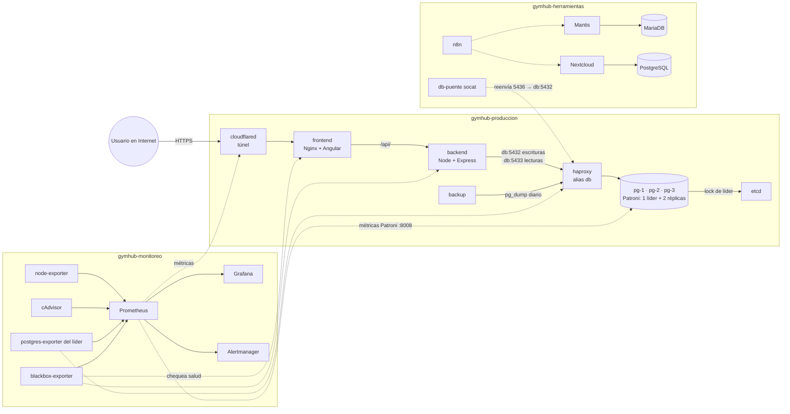
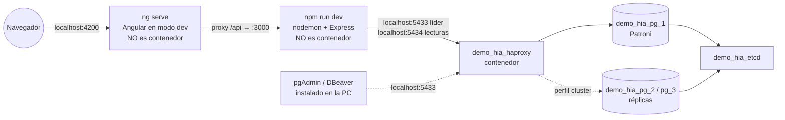

# Contenedores de GymHub: qué hace cada uno y cómo se relacionan

Guía de estudio. Para el montaje completo de producción (CD, rollback, túnel, Tailscale) ver [PRODUCCION.md](PRODUCCION.md).

## Índice

- **[0. Desarrollo vs. producción: la idea](#0-desarrollo-vs-producción-la-idea)**
- **PARTE 1: PRODUCCIÓN**
  - [1. Panorama general](#1-panorama-general)
  - [2. Grupo gymhub-produccion](#2-grupo-gymhub-produccion-9-contenedores)
  - [3. Grupo gymhub-monitoreo](#3-grupo-gymhub-monitoreo-7-contenedores)
  - [4. Grupo gymhub-herramientas](#4-grupo-gymhub-herramientas-6-contenedores)
  - [5. Cómo se relacionan los grupos](#5-cómo-se-relacionan-los-grupos-entre-sí)
  - [6. Cómo se accede a cada cosa](#6-cómo-se-accede-a-cada-cosa)
  - [7. ¿Qué pasa si se cae…?](#7-qué-pasa-si-se-cae)
- **PARTE 2: DESARROLLO**
  - [8. Cómo funciona en desarrollo](#8-cómo-funciona-en-desarrollo)
- **COMPARACIÓN**
  - [9. Contenedor por contenedor: desarrollo vs. producción](#9-contenedor-por-contenedor-desarrollo-vs-producción)
  - [10. Resumen en una frase por contenedor](#10-resumen-en-una-frase-por-contenedor)

---

## 0. Desarrollo vs. producción: la idea

El proyecto tiene **dos entornos**. Usan las mismas piezas (frontend, backend, PostgreSQL), pero **armadas distinto** porque tienen objetivos distintos:

| | **Desarrollo** | **Producción** |
|---|---|---|
| **Para qué** | Programar y probar cambios rápido | Que la app ande siempre, para usuarios reales |
| **Quién lo usa** | Cada integrante en su PC | El público, por Internet |
| **Dónde corre** | En la PC de **cada integrante** (Windows o Mac, con Docker Desktop) | En **un solo servidor**: la PC de escritorio de Francisco, que hace de servidor del equipo |
| **De dónde sale el código** | De la carpeta local, tal como se está editando | De imágenes ya construidas y probadas por el CI, publicadas en GHCR |
| **Cómo se actualiza** | Al guardar un archivo se recarga solo (nodemon, `ng serve`) | Push a `main` → CI → CD → `deploy.sh` |
| **Base de datos** | Datos de prueba (seed con `demo1234`), se puede borrar y recrear. Cluster Patroni de 1 nodo (o 3 con `cluster`) | Datos reales; cluster Patroni de 3 nodos con failover automático, backups diarios |
| **Puertos de la base** | **Publicados** por HAProxy en localhost (5433 = líder, 5434 = lecturas) | **Sin puertos**; solo por el puente 5436 |
| **Secretos** | Valores de ejemplo en `.env` / `backend/.env` | Aleatorios, en `produccion/.env.prod` |
| **Acceso desde afuera** | Ninguno | Cloudflare (app) y Tailscale (administración) |
| **Si algo falla** | Se corrige y se sigue; no afecta a nadie más | Rollback automático a la versión anterior |
| **Proyecto Compose** | `proyecto_demo_hia` | `gymhub-produccion` |
| **Nombres** | `demo_hia_*`, `gymhub_*_dev` | `gymhub_*_prod` |
| **Redes y volúmenes** | `gymhub_db_net`, `gymhub_db_data`… | `gymhub_prod_*` (separados: nunca se mezclan los datos) |

> Regla mental: **en desarrollo, la comodidad; en producción, la seguridad y la estabilidad.** Por eso en desarrollo la base tiene puertos abiertos y contraseñas simples, y en producción no.

Los grupos **monitoreo** y **herramientas** existen **una sola vez, en el servidor**, y los comparte todo el equipo. Allí están configurados mirando a **producción** (ver [sección 8.4](#84-monitoreo-y-herramientas-en-desarrollo)).

### ¿Qué tiene que tener cada integrante?

| Quién | Qué corre en su PC | Cómo usa el resto |
|---|---|---|
| **Cada integrante** | Solo el entorno de **desarrollo** (Parte 2): la base en Docker y el backend y el frontend con npm | La app pública por la URL de Cloudflare; Grafana, Mantis, Nextcloud, etc. por **Tailscale** (sección 6) |
| **Servidor** (PC de Francisco) | Desarrollo **y** los 22 contenedores de **producción**, más el runner del CD | — |

Nadie tiene que instalar producción ni monitoreo en su PC: **se despliega solo** cuando se mergea a `main`.

---

# PARTE 1: PRODUCCIÓN

## 1. Panorama general

En el servidor (la PC de escritorio de Francisco) corren **22 contenedores de GymHub de producción**, ordenados en **3 grupos** de Docker Desktop. Cada grupo es un *proyecto de Docker Compose*: se levantan, se bajan y se ven juntos.

| Grupo | Para qué sirve | Contenedores |
|---|---|---|
| **gymhub-produccion** | La aplicación en sí: lo que usa el público | 9 |
| **gymhub-monitoreo** | Vigilar que la aplicación y el servidor estén bien | 7 |
| **gymhub-herramientas** | Herramientas del equipo: incidencias, automatización, documentos, acceso a la base | 6 |

Una forma simple de pensarlo:

- **Producción** es *el gimnasio funcionando*.
- **Monitoreo** son *las cámaras y alarmas*.
- **Herramientas** es *la oficina del equipo*.



> Las flechas llenas son el camino normal de los datos. Las punteadas son conexiones de vigilancia o administración.

---

## 2. Grupo `gymhub-produccion` (9 contenedores)

Se define en `compose.yaml`, `compose.prod.yaml` y `compose.tunnel.yaml`. Lo levanta `scripts/deploy.sh`, que corre el CD en cada push a `main`.

### 2.1 `gymhub_frontend_prod`: la cara visible
- **Imagen:** `ghcr.io/valentiniriar/gymhub-web:<SHA>`. La construye el CD y la publica en GitHub Container Registry.
- **Qué tiene adentro:** la aplicación **Angular** ya compilada (HTML, JS y CSS) servida por **Nginx**.
- **Qué hace:**
  1. Le entrega al navegador la aplicación web.
  2. Hace de **proxy reverso**: todo lo que llega a `/api/...` lo reenvía al backend (`http://backend:3000`). Ver `frontend/nginx.conf`.
  3. Agrega encabezados de seguridad, como `Permissions-Policy`.
- **Puerto:** `127.0.0.1:80`. Solo es accesible desde la propia PC; al público le llega por el túnel.
- **Se relaciona con:** recibe tráfico de **cloudflared**, se lo pasa al **backend** y lo vigila el **blackbox-exporter**.

### 2.2 `gymhub_backend_prod`: el cerebro
- **Imagen:** `ghcr.io/valentiniriar/gymhub-backend:<SHA>`.
- **Qué tiene adentro:** la API en **Node.js + Express 5**, con **Sequelize** como ORM. Las rutas están en `backend/src/routes`: auth, usuarios, rutinas, ejercicios, pagos, suscripciones, tarifas, nutrición, IA, YouTube, etc.
- **Qué hace:** la lógica de negocio. Valida usuarios con **JWT**, controla roles (admin, entrenador, socio) y lee y escribe en la base.
- **Separa lecturas de escrituras** (SCRUM-47, `backend/config/database.js`):
  - los **INSERT/UPDATE/DELETE** van a `db:5432`, que HAProxy manda siempre al **líder** del cluster;
  - los **SELECT** van a `db:5433`, que HAProxy reparte entre las **réplicas** (y el líder).

  Así se reparte la carga.
- **Healthcheck:** `/api/health` responde 200 si la API y la base están bien. Lo usan el deploy, para decidir si hay que hacer rollback, y el monitoreo.
- **No publica puertos:** solo se llega a él desde la red interna de Docker.
- **Se relaciona con:** recibe pedidos del **frontend** y habla con la base **solo a través de HAProxy** (`db`). Si cambia el líder, no hay que tocarlo: reconecta solo.

### 2.3 `gymhub_pg_1_prod`, `gymhub_pg_2_prod`, `gymhub_pg_3_prod`: el cluster de base de datos (Patroni)
- **Imagen:** `gymhub-patroni:16`, construida desde `database/patroni/` (`postgres:16-alpine` + Patroni).
- **Qué hacen:** guardan **todos los datos** de GymHub. Son **tres nodos iguales**: en cada momento **uno es el líder** (el único que acepta escrituras) y **los otros dos son réplicas** que reciben cada cambio por *streaming replication* (WAL).
- **Failover automático:** si el líder se cae, Patroni promueve sola a la réplica más actualizada en segundos, y cuando el nodo caído vuelve se reincorpora solo como réplica (`pg_rewind`). Ver **[docs/implementacion-patroni.MD](docs/implementacion-patroni.MD)**.
- **Configuración:** `database/patroni/patroni.yml` (común a los tres) + `database/config/postgresql.conf` (memoria, WAL, etc.) y `shm_size: 256mb`, necesario para consultas paralelas (SCRUM-39).
- **Primer arranque:** si el volumen de `pg-1` está vacío, Patroni crea el cluster y `post-bootstrap.sh` carga `01_schema.sql` y `02_seed.sql`. Si ya tiene datos, los **adopta**. `pg-2` y `pg-3` se clonan solos del líder.
- **Datos persistentes:** volúmenes `gymhub_prod_db_data` (pg-1), `gymhub_prod_db_replica_data` (pg-2) y `gymhub_prod_db_replica2_data` (pg-3).
- **Ver el estado:** `docker exec gymhub_pg_1_prod patronictl -c /etc/patroni/patroni.yml list`.
- **Se relacionan con:** **etcd** (para elegir líder), **HAProxy** (que les manda las conexiones) y **Prometheus** (que lee sus métricas por la API de Patroni, `:8008`).

### 2.4 `gymhub_etcd_prod` y `gymhub_haproxy_prod`: quién es el líder y cómo se llega a él
- **etcd** (`quay.io/coreos/etcd`): guarda **quién es el líder** con una clave que vence a los 20 s si el líder deja de renovarla. No guarda datos de la app. Hay uno solo para ahorrar recursos; si se cae, el líder sigue escribiendo (`failsafe_mode`), pero no puede haber failover hasta que vuelva.
- **HAProxy** (`haproxy:3.2-alpine`): tiene el nombre de red **`db`**. En `db:5432` manda todo al líder y en `db:5433` reparte las lecturas. Para saber quién es quién, pregunta a cada nodo por su API (`OPTIONS /primary`). Así el backend, el backup y el puente siguen usando `db:5432` como siempre.
- **Por qué hacen falta:** sin etcd los nodos no podrían ponerse de acuerdo sin riesgo de tener dos líderes; sin HAProxy, después de un failover habría que cambiar la configuración del backend.

### 2.5 `gymhub_backup_prod`: copias de seguridad
- **Imagen:** `gymhub-backup:latest`, construida localmente desde `database/backup/`.
- **Qué hace:** un **cron** interno ejecuta `pg_dump` contra la primaria **todos los días a las 03:00** y además al arrancar. Guarda los dumps en el volumen `gymhub_prod_db_backups` y **borra los de más de 7 días**.
- **Restaurar:** `database/backup/restore.sh`.
- **¿Por qué hace falta si ya hay réplicas?** Una réplica copia *todo*, también los errores: si alguien borra una tabla, la réplica la borra también. El backup es una **foto del pasado** a la que se puede volver.
- **Se relaciona con:** solo con **db** (HAProxy → el líder), a la que lee.

### 2.6 `gymhub_cloudflared_rapido`: la puerta a Internet
- **Imagen:** `cloudflare/cloudflared` (versión fijada por digest).
- **Qué hace:** abre un **túnel de salida** hacia Cloudflare y recibe una URL pública `https://<palabras>.trycloudflare.com`. Cloudflare entrega por ese túnel las visitas a `frontend:8080`.
- **Por qué es seguro:** el servidor **no abre ningún puerto** en el router. La conexión sale desde adentro hacia Cloudflare, que también aporta HTTPS.
- **Detalle importante:** es un *quick tunnel*. **Si el contenedor se reinicia, la URL cambia.** Por eso `deploy.sh` no lo recrea y `infra/monitoring/publicar-target.sh` le avisa a Prometheus la URL nueva.
- **Métricas:** expone `:2000`, que Prometheus lee (alertas `GymHubTunelCaido` y otras).
- **Se relaciona con:** con el **frontend** (le manda el tráfico) y con **Prometheus** (lo vigila).

### Redes y volúmenes de producción

| Red | Quién está | Para qué |
|---|---|---|
| `gymhub_prod_frontend_net` | frontend, backend, cloudflared, más Prometheus y blackbox | Tráfico web |
| `gymhub_prod_db_net` | backend, haproxy (`db`), pg-1..3, etcd, backup, más Prometheus, el exporter y db-puente | Tráfico de base de datos |

El **frontend no está en la red de la base**: aunque alguien lo comprometiera, no llegaría directo a PostgreSQL. Es **segmentación de red**.

---

## 3. Grupo `gymhub-monitoreo` (7 contenedores)

Se define en `infra/monitoring/docker-compose.yml` más el agregado `docker-compose.prod.yml`. Se levanta con `bash scripts/infra.sh levantar`.

La idea: los **exporters** *miden*, **Prometheus** *junta y guarda*, **Grafana** *muestra* y **Alertmanager** *avisa*.

### 3.1 `gymhub-prometheus-scrum66`: el recolector
- **Qué hace:** cada 15 segundos **pregunta** (*scrape*) a cada exporter sus números y los guarda como series de tiempo. Además **evalúa las reglas de alerta** (`alerts/gymhub.rules.prod.yml`, unas 18 reglas).
- **Configuración:** `infra/monitoring/prometheus/prometheus.prod.yml`.
- **Puerto:** `127.0.0.1:9091`.
- **Se relaciona con:**
  - lee de todos los exporters y de cloudflared;
  - le manda las alertas a **Alertmanager**;
  - **Grafana** lo consulta.

  Está en la red de monitoreo y también en la red web de producción, para llegar a frontend, backend y túnel.

### 3.2 `gymhub-grafana-scrum66`: los tableros
- **Qué hace:** muestra gráficos. Toma los datos de Prometheus y los dibuja en el dashboard **"GymHub | Producción"**: CPU, memoria, estado de la base, **qué nodo es el líder**, atraso de las réplicas, cambios de líder, si la web responde, etc.
- **Puerto:** `127.0.0.1:3001`.
- **Se relaciona con:** solo con **Prometheus**, como fuente de datos.

### 3.3 `gymhub-alertmanager-scrum68`: el que avisa
- **Qué hace:** recibe las alertas que dispara Prometheus. Las **agrupa** (para no mandar 50 mensajes iguales), las **silencia** si se pide y decide **a quién avisar**.
- **Estado actual:** en este servidor usa `alertmanager.yml` con un receptor *sin notificaciones*: las alertas se ven en su web, pero no se mandan a ningún lado. Hay un ejemplo listo (`alertmanager.scrum76.example.yml`) para mandarlas a **n8n**, que crearía una incidencia en Mantis (SCRUM-76).
- **Puerto:** `127.0.0.1:9093`.

### 3.4 `gymhub-node-exporter-scrum66`: métricas del servidor
- **Qué mide:** el **equipo anfitrión**: CPU, RAM, disco, red. En Docker Desktop, el anfitrión es la máquina virtual Linux donde corren los contenedores.

### 3.5 `gymhub-cadvisor-scrum66`: métricas de cada contenedor
- **Qué mide:** cuánta CPU, memoria y red usa **cada contenedor** y cuántas veces se reinició. Lee del socket de Docker.
- **Alertas relacionadas:** `GymHubDockerCpuHigh`, `GymHubDockerMemoryHigh`, `GymHubReiniciosObservadosCadvisor`.

### 3.6 `gymhub-postgres-exporter-scrum66`: métricas del líder
- **Qué mide:** el estado interno de PostgreSQL en **db** (HAProxy → siempre el líder, sea cual sea): conexiones, transacciones, tamaño, si está viva, el replication slot.
- **Usuario:** se conecta con `gymhub_monitor`, un rol con permiso `pg_monitor` que **solo puede leer estadísticas**, no datos de los usuarios.
- **Alertas:** `GymHubPostgresPrimaryUnavailable`, `GymHubPostgresConnectionsHigh`.

### 3.7 Métricas del cluster Patroni (sin contenedor propio)
- Prometheus lee directamente la API de cada nodo (`pg-1:8008/metrics`, job `patroni`): quién es líder, si cada réplica está en streaming, el atraso en bytes y el *timeline* (que sube en cada cambio de líder).
- **Alertas:** `GymHubNodoPatroniCaido`, `GymHubSinLider`, `GymHubDosLideres`, `GymHubFailoverOcurrido`, `GymHubReplicasInsuficientes`, `GymHubReplicaLagAlto`.
- Reemplaza al antiguo exporter de réplica, que suponía que la réplica era siempre el mismo contenedor.

### 3.8 `gymhub-blackbox-scrum66`: pruebas desde afuera
- **Qué hace:** en vez de medir *desde adentro*, **actúa como un usuario**: hace pedidos HTTP y anota si respondieron, en cuánto tiempo y con qué código.
- **Qué prueba:**
  - `http://backend:3000/api/health`: el backend directo.
  - `http://frontend:8080/api/health`: el camino completo Nginx → backend → base.
  - La **URL pública** de Cloudflare, por HTTPS, incluyendo el vencimiento del certificado.
- **Alertas:** `GymHubBackendUnavailable`, `GymHubFrontendUnavailable`, `GymHubUrlPublicaCaida`, `GymHubUrlPublicaLenta`, `GymHubCertificadoPorVencer`.

### Cómo viaja una alerta, paso a paso
1. El backend se cae.
2. **blackbox** prueba `/api/health` y falla.
3. **Prometheus** guarda `probe_success = 0`.
4. La regla `GymHubBackendUnavailable` se cumple durante el tiempo configurado y pasa a *firing*.
5. **Alertmanager** la recibe y la muestra (y, con SCRUM-76 activo, la mandaría a n8n, que abriría una incidencia en Mantis).
6. En **Grafana** se ve el panel en rojo.

---

## 4. Grupo `gymhub-herramientas` (6 contenedores)

Herramientas de **gestión del proyecto**. No forman parte de la aplicación: si se caen, GymHub sigue funcionando.

### 4.1 `gymhub-mantis`: gestor de incidencias (bugs)
- **Qué es:** **MantisBT**, un sistema para registrar errores e incidencias: quién lo reportó, prioridad, estado, notas. Es el "Jira de los bugs" del TP.
- **Imagen:** `gymhub-mantis:2.28.4`, construida desde `infra/mantis/`.
- **Puerto:** `127.0.0.1:8990`.
- **Se relaciona con:** guarda todo en **mantis-db**, y **n8n** le crea incidencias por su API REST.

### 4.2 `gymhub-mantis-db`: base de Mantis
- **Imagen:** `mariadb:11.4`. Mantis usa MySQL/MariaDB, no PostgreSQL.
- **Red aislada:** `gymhub_mantis_internal`. Solo Mantis llega a ella.

### 4.3 `gymhub-n8n-scrum75`: automatizaciones
- **Qué es:** **n8n**, una herramienta de **flujos automáticos** visuales del tipo "cuando pasa X, hacé Y", parecida a Zapier.
- **Flujos del proyecto** (`infra/n8n/workflows/`):
  - **Verificación de backups:** todos los días a las 04:00 revisa que el backup de las 03:00 exista y sea reciente; si no, **crea una incidencia en Mantis**.
  - **Eventos de seguridad:** recibe eventos del backend (por ejemplo, logins fallidos) y los registra.
  - **SCRUM-76 Alertmanager → Mantis:** convierte alertas de Prometheus en incidencias, sin duplicarlas.
  - **Manejo de errores:** si un flujo falla, avisa por correo.
- **Puerto:** `127.0.0.1:5679`.
- **Ojo:** tiene `restart: 'no'`, así que **no arranca solo** después de reiniciar el servidor.
- **Se relaciona con:** **Mantis** y **Nextcloud**, por la red `gymhub_tools_net`; ahí se llaman por nombre (`http://mantis`, `http://nextcloud`).

### 4.4 `gymhub-nextcloud`: gestión documental
- **Qué es:** **Nextcloud**, un "Google Drive propio". Es el repositorio de documentos del equipo (SCRUM-73/74).
- **Estructura:** carpetas `01-Diagnóstico` … `15-Final`, una por etapa del TP, más `Informes-IA`.
- **Usuarios:** uno por integrante (grupo `equipo`), `docente` (solo lectura) y `n8n-bot`.
- **Permisos por grupo** y **sin enlaces públicos**.
- **Puerto:** `127.0.0.1:8082`.
- **Se relaciona con:** guarda sus datos en **nextcloud-db**. **n8n** le sube informes por WebDAV en `http://nextcloud/remote.php/dav/files/n8n-bot/Informes-IA/`.

### 4.5 `gymhub-nextcloud-db`: base de Nextcloud
- **Imagen:** `postgres:16-alpine`. Es una base **distinta** de la de GymHub: solo guarda usuarios, permisos y metadatos de Nextcloud.
- **Red interna** `gymhub_nextcloud_internal` (`internal: true`): sin salida a Internet y solo accesible para Nextcloud.

### 4.6 `gymhub_db_puente`: acceso administrativo a la base
- **Imagen:** `alpine/socat`. Es un programa mínimo que **reenvía conexiones TCP**.
- **Qué hace:** escucha en `127.0.0.1:5436` y reenvía todo a `db:5432`, la primaria de producción.
- **¿Por qué hace falta?** La base de producción **no publica ningún puerto**, a propósito. Sin el puente, pgAdmin no tendría por dónde entrar. Es una puerta controlada: solo escucha en localhost y, por Tailscale, en la tailnet del equipo.
- **Seguridad:** solo lectura de disco, sin privilegios (`cap_drop: ALL`) y con 32 MB de RAM como máximo.
- **Se relaciona con:** está conectado a la red `gymhub_prod_db_net` de producción.

---

## 5. Cómo se relacionan los grupos entre sí

Los grupos son independientes, pero se "tocan" a través de **redes compartidas**:

| Desde (grupo) | Hacia (grupo) | Por qué red | Para qué |
|---|---|---|---|
| Prometheus, blackbox (monitoreo) | frontend, backend, cloudflared (producción) | `gymhub_prod_frontend_net` | Chequear salud y leer métricas del túnel |
| Prometheus, postgres-exporter (monitoreo) | pg-1..3 (`:8008`), HAProxy `db` (producción) | `gymhub_prod_db_net` | Métricas de Patroni y de PostgreSQL |
| db-puente (herramientas) | db (producción) | `gymhub_prod_db_net` | Entrar con pgAdmin |
| n8n (herramientas) | Mantis, Nextcloud (herramientas) | `gymhub_tools_net` | Crear incidencias y subir informes |
| Alertmanager (monitoreo) | n8n (herramientas) | `gymhub_tools_net` *(SCRUM-76, todavía no activo acá)* | Convertir alertas en incidencias |

**Orden de arranque:** producción primero, porque crea las redes `gymhub_prod_*` que los otros grupos usan como `external`. Después monitoreo y herramientas (`bash scripts/infra.sh levantar`).

---

## 6. Cómo se accede a cada cosa

Ningún servicio escucha en `0.0.0.0`: **todo está en `127.0.0.1`**, es decir, solo desde el propio servidor. Para el resto del equipo hay dos caminos:

- **Público:** solo la app. Cualquiera entra, sin instalar nada.
  - **URL fija (principal):** https://gymhub-servidor.tailec3350.ts.net, publicada con **Tailscale Funnel**. No cambia aunque se reinicie el servidor.
  - **Respaldo:** el túnel rápido de Cloudflare (`…trycloudflare.com`), cuya URL cambia en cada reinicio.
- **Tailscale (privado, solo el equipo):** todo lo de administración. Es una red privada virtual: cada integrante instala Tailscale en su PC o celular, se une a la red del equipo y desde ahí ve el servidor como si estuviera en la misma casa. Desde la LAN o desde Internet, en cambio, no se ve nada.

| Servicio | En el servidor | Desde la PC de un integrante (Tailscale) | Por Internet (público) |
|---|---|---|---|
| App GymHub | http://localhost | `:80` | ✅ **https://gymhub-servidor.tailec3350.ts.net** (fija, Funnel) y la de trycloudflare (respaldo) |
| Grafana | http://localhost:3001 | `:3001` | ❌ |
| Prometheus | http://localhost:9091 | `:9091` | ❌ |
| Alertmanager | http://localhost:9093 | `:9093` | ❌ |
| Mantis | http://localhost:8990 | `:8990` | ❌ |
| n8n | http://localhost:5679 | `:5679` | ❌ |
| Nextcloud | http://localhost:8082 | `:8082` | ❌ |
| URL pública vigente del túnel | http://localhost:2000/quicktunnel | `:2000/quicktunnel` | ❌ |
| Estado de HAProxy (qué nodo de Patroni es líder) | http://localhost:7000 | `:7000` | ❌ |
| Base de producción | `localhost:5436` | `:5436` | ❌ |

En la tailnet, el host es `gymhub-servidor.tailec3350.ts.net`. Por ejemplo, Grafana queda en `http://100.65.22.99:3001/`.

**Para que un integrante tenga acceso:**
1. Instalar Tailscale ([tailscale.com/download](https://tailscale.com/download)) y pedirle a Francisco, que administra la tailnet, que lo invite.
2. Pedirle sus credenciales **por privado**. Cada uno tiene su usuario en Nextcloud y Mantis. Las credenciales están solo en el servidor (`produccion/CREDENCIALES.txt` e `infra/*/.env`), **nunca en el repo, en Jira ni en el grupo de chat**.
3. Para la base de producción (pgAdmin o DBeaver): host `gymhub-servidor.tailec3350.ts.net`, puerto `5436`.

La URL de respaldo de Cloudflare cambia cada vez que se reinicia el túnel. La vigente se consulta desde cualquier dispositivo de la tailnet en `http://100.65.22.99:2000/quicktunnel` (devuelve `{"hostname": "…trycloudflare.com"}`).

---

## 7. ¿Qué pasa si se cae…?

Sirve para entender las dependencias y para preguntas de la defensa:

| Se cae… | Efecto | Quién se entera |
|---|---|---|
| **cloudflared** | La web deja de verse desde Internet; en el servidor y por Tailscale sigue andando | `GymHubTunelCaido`, `GymHubUrlPublicaCaida` |
| **frontend** | No hay web (ni pública ni local) | `GymHubFrontendUnavailable` |
| **backend** | La web carga pero no hay login ni datos | `GymHubBackendUnavailable` |
| **El nodo líder** (pg-1, 2 o 3) | Patroni promueve otra réplica: las escrituras se cortan unos segundos (~6 s con apagado ordenado, ~25 s con caída abrupta) y vuelven solas | `GymHubNodoPatroniCaido`, `GymHubFailoverOcurrido` |
| **Una réplica** | Las lecturas pasan a los otros nodos; nada visible para el usuario | `GymHubNodoPatroniCaido`, `GymHubReplicasInsuficientes` |
| **etcd** | El líder sigue escribiendo (`failsafe_mode`), pero no puede haber failover hasta que vuelva | `GymHubSinLider` solo si además cae el líder |
| **haproxy** | La app pierde la base (los nodos siguen bien) | `GymHubPostgresPrimaryUnavailable`, `GymHubBackendUnavailable` |
| **backup** | Nada visible al momento, pero no hay copias nuevas | Flujo de n8n de verificación de backups |
| **Prometheus** | Nadie vigila: no hay alertas ni gráficos nuevos | Grafana sin datos |
| **Mantis / n8n / Nextcloud** | La app sigue normal; solo afecta al equipo | — |
| **El servidor entero** (apagado, reinicio por Windows Update) | Todo cae para todo el equipo; al volver, Docker levanta casi todo solo, salvo n8n y el runner. La URL fija de Funnel vuelve sola; la de Cloudflare cambia | — |

---

# PARTE 2: DESARROLLO

## 8. Cómo funciona en desarrollo

Esto es lo que **cada integrante** tiene en su PC. Cada uno tiene **su propia base de desarrollo** con sus datos de prueba: lo que alguien rompa en la suya no afecta a nadie más.

**Primera vez:**
```bash
cp .env.example .env                    # variables de la base de desarrollo
cp backend/.env.example backend/.env    # variables del backend
cd backend && npm install && cd ../frontend && npm install
```
Los puertos de abajo son los **valores por defecto** de los `.env.example`. Si en una PC un puerto ya está ocupado por otro proyecto, se cambia en el `.env` de esa PC (por ejemplo, en el servidor HAProxy publica el líder en 5434 y las lecturas en 5435).

En desarrollo hay **dos formas de trabajar**. Las dos usan el proyecto Compose `proyecto_demo_hia`, que es independiente de producción.

### 8.1 Forma A, la habitual: solo la base en Docker y el código con npm

Es la que se usa día a día, porque **cada cambio se ve al instante** sin reconstruir imágenes.



**Cómo se levanta:**
```bash
docker compose -f docker-compose.yml --profile dev up -d                    # base de 1 nodo (pg-1 + etcd + HAProxy)
docker compose -f docker-compose.yml --profile dev --profile cluster up -d  # 1 líder + 2 réplicas (failover)
cd backend  && npm run dev                              # API en localhost:3000
cd frontend && npm start                                # web en localhost:4200
```

**Qué hay en cada lugar:**

| Pieza | ¿Contenedor? | Dónde | Detalle |
|---|---|---|---|
| **Frontend** | ❌ Proceso de Node | `localhost:4200` | `ng serve` compila en memoria y **recarga el navegador** al guardar. Lo que va a `/api` lo reenvía a `localhost:3000` (`frontend/proxy.conf.json`). Es el equivalente en desarrollo de lo que hace Nginx en producción. |
| **Backend** | ❌ Proceso de Node | `localhost:3000` | `nodemon` **reinicia la API** al guardar un `.js`. Lee `backend/.env` (`DB_HOST=localhost`, `DB_PORT=5433`). |
| **`demo_hia_haproxy`** | ✅ `haproxy:3.2-alpine` | `127.0.0.1:5433` (líder), `:5434` (lecturas), `:7000` (estado) | La **única puerta** a la base desde la PC: el backend (fuera de Docker) y pgAdmin entran por acá y siempre llegan al líder |
| **`demo_hia_pg_1`** | ✅ `gymhub-patroni:16` | — (por HAProxy) | Nodo Patroni. Mismo `schema.sql`, `seed.sql` y `postgresql.conf` que producción |
| **`demo_hia_pg_2`, `demo_hia_pg_3`** | ✅ (perfil `cluster`) | — (por HAProxy) | Réplicas para probar replicación y **failover automático** sin tocar producción. **Opcionales** |
| **`demo_hia_etcd`** | ✅ `etcd` | — | Guarda quién es el líder |
| **`demo_hia_backup`** | ✅ (perfil `backups`) | — | Opcional, para probar backups y restores. |
| **`demo_hia_pgadmin`** | ✅ (perfil `tools`) | `127.0.0.1:5050` | pgAdmin en contenedor con el servidor ya cargado. Opcional. |
| **`demo_hia_adminer`** | ✅ (perfil `adminer`) | `127.0.0.1:8080` | Alternativa liviana a pgAdmin. Opcional. |

**Los perfiles** (`--profile`) son la clave de `docker-compose.yml`: el mismo archivo define todos los servicios, pero **solo arrancan los de los perfiles indicados**. Así cada uno levanta solo lo que necesita.

> ⚠️ Hace falta `-f docker-compose.yml`: en la carpeta también está `compose.yaml` (Forma B / producción) y Compose elegiría ese. Cómo probar que al bajar el maestro otro nodo toma el control solo: **[docs/implementacion-patroni.MD](docs/implementacion-patroni.MD)**.

### 8.2 Forma B: todo en contenedores (para probar como en producción)

Sirve para verificar que **las imágenes Docker** funcionan antes de subir los cambios, porque es lo más parecido a producción que se puede tener en una PC de desarrollo:

```bash
docker compose -f compose.yaml -f compose.dev.yaml up -d --build
docker compose -f compose.yaml -f compose.dev.yaml --profile cluster up -d   # + 2 réplicas (pg-2, pg-3)
```

| Contenedor | Puerto | Diferencia con producción |
|---|---|---|
| `gymhub_frontend_dev` | `127.0.0.1:8080` | Mismo Dockerfile y mismo Nginx, pero la imagen **se construye en la PC del integrante** (`build:`) en vez de bajarse de GHCR |
| `gymhub_backend_dev` | `127.0.0.1:3000` | Puerto publicado (en producción no); `NODE_ENV=development`; JWT de ejemplo; usa una sola base (`DB_HOST=db`) |
| `gymhub_haproxy_dev` + `gymhub_pg_1..3_dev` + `gymhub_etcd_dev` | HAProxy: `DB_PORT` / `DB_REPLICA_PORT` del `.env` (por defecto 5433 / 5434) y `:7000` | **Con puertos publicados** (en producción, sin puertos). No levantar a la vez que la Forma A: comparten red y puertos |
| `demo_hia_pgadmin` | `127.0.0.1:5050` | No existe en producción: allá se entra por el puente |

**El truco de los archivos superpuestos.** `compose.yaml` es la **base común**: servicios, healthchecks, redes y límites de recursos. Encima se apila:
- `compose.dev.yaml`: agrega `build`, puertos y valores de prueba.
- `compose.prod.yaml`: cambia a imágenes de GHCR, quita puertos y exige secretos (`${DB_PASS:?…}` falla si falta).

Así **no se duplica** la configuración: lo que cambia entre entornos vive en un archivo chico.

### 8.3 El camino de un cambio: de la PC de un integrante a producción

Esto vale para **cualquier integrante**: nadie necesita acceso al servidor para desplegar. Alcanza con que el cambio llegue a `main` por PR.

```mermaid
flowchart LR
  A[Se edita el código<br/>Forma A: npm run dev] --> B[Se prueba en<br/>localhost:4200]
  B --> C[Opcional: Forma B<br/>todo en contenedores]
  C --> D[Push a feature/*<br/>PR a develop]
  D --> E[CI: lint, tests,<br/>build de imágenes]
  E --> F[Release develop → main]
  F --> G[CD: publica imágenes<br/>en GHCR con el SHA]
  G --> H[Runner en el servidor:<br/>deploy.sh SHA]
  H --> I[gymhub-produccion<br/>actualizado]
```



Lo importante: **en producción nunca se compila código.** Se usa exactamente la imagen que construyó y probó el CI, identificada por el SHA del commit. Por eso se puede volver atrás (rollback) con certeza.

### 8.4 Monitoreo y herramientas en desarrollo

Los composes de `infra/` tienen **dos modos**:

| | Modo desarrollo (base) | Modo producción (el que está activo en el servidor) |
|---|---|---|
| **Monitoreo** | `infra/monitoring/docker-compose.yml` + `prometheus.yml` | Se le suma `docker-compose.prod.yml` + `prometheus.prod.yml` (lo genera `generar-prod.sh`) |
| Prometheus | Puerto por defecto 9090 | 9091 (en el servidor el 9090 está ocupado por otro proyecto) |
| postgres-exporter | Llega a la base por `host.docker.internal:<puerto publicado>` (la base de dev **tiene** puerto) | Entra a la red `gymhub_prod_db_net` y habla con `db:5432` (la base de prod **no tiene** puerto) |
| Métricas de Patroni (job `patroni`) | Sumar `docker-compose.patroni-dev.yml`: Prometheus entra a `gymhub_db_net` y lee `pg-1..3:8008` | Prometheus está en `gymhub_prod_db_net` y lee `pg-1..3:8008` |
| blackbox / Prometheus | Solo en la red de monitoreo | También en `gymhub_prod_frontend_net`, para probar `frontend` y `backend` por nombre |
| **Herramientas** (Mantis, n8n, Nextcloud) | Igual en ambos modos: son **del equipo**, no de un entorno | Igual + `db-puente`, que **solo existe en producción** (en dev no hace falta: la base ya tiene puerto) |

`bash scripts/infra.sh levantar` arranca siempre el modo producción.

---

# COMPARACIÓN

## 9. Contenedor por contenedor: desarrollo vs. producción

| Pieza | Desarrollo (Forma A) | Desarrollo (Forma B) | Producción |
|---|---|---|---|
| Frontend | `ng serve` en :4200 (sin contenedor) | `gymhub_frontend_dev` :8080, construido local | `gymhub_frontend_prod` :80, imagen de GHCR |
| Cómo llega `/api` al backend | Proxy de Angular (`proxy.conf.json`) | Nginx → `backend:3000` | Nginx → `backend:3000` |
| Backend | `npm run dev` en :3000 (sin contenedor) | `gymhub_backend_dev` :3000 | `gymhub_backend_prod`, **sin puerto** |
| Lecturas y escrituras | Escrituras → líder (5433), lecturas → 5434 | Todo a `db:5432` (líder) | Escrituras → `db:5432` (líder), lecturas → `db:5433` (réplicas) |
| Base (cluster Patroni) | `demo_hia_pg_1` + HAProxy :5433 | `gymhub_pg_1_dev` + HAProxy :5433 | `gymhub_pg_1..3_prod` + HAProxy, **sin puerto** |
| Réplicas y failover automático | Opcionales (`cluster`): `demo_hia_pg_2`, `demo_hia_pg_3` | Opcionales (`cluster`) | Siempre: 2 réplicas |
| Backup | Opcional (`backups`) | Opcional | Siempre, diario 03:00, 7 días |
| pgAdmin | Instalado en la PC o contenedor :5050 → :5433 | Contenedor :5050 | Por Tailscale → `gymhub-servidor…:5436` (en el servidor: `localhost:5436`) |
| Dónde está | En la PC de cada integrante | En la PC de cada integrante | Solo en el servidor |
| Túnel público | ❌ | ❌ | ✅ cloudflared |
| Datos | Seed de prueba (`demo1234`) | Seed de prueba | Reales, contraseñas rotadas |
| Secretos | `.env`, `backend/.env` (ejemplo) | `.env` (ejemplo) | `produccion/.env.prod` (aleatorios) |
| Volúmenes | `gymhub_db_data`… | `gymhub_db_data`… | `gymhub_prod_db_data`… |
| Recarga al cambiar código | ✅ instantánea | ❌ hay que reconstruir (`--build`) | ❌ solo vía CI/CD |

---

## 10. Resumen en una frase por contenedor

| Contenedor | En una frase |
|---|---|
| frontend | Nginx que sirve la web Angular y reenvía `/api` al backend |
| backend | API Node/Express con la lógica, JWT y separación de lecturas y escrituras |
| pg-1, pg-2, pg-3 | Nodos PostgreSQL con Patroni: uno es líder (escribe) y dos réplicas; si cae el líder, otro toma el control solo |
| etcd | Guarda quién es el líder del cluster |
| haproxy | Puerta única a la base (`db`): manda escrituras al líder y lecturas a las réplicas |
| backup | `pg_dump` diario a las 03:00, guarda 7 días |
| cloudflared | Túnel que publica la web en Internet sin abrir puertos |
| prometheus | Junta métricas cada 15 s y evalúa alertas |
| grafana | Dibuja las métricas en tableros |
| alertmanager | Agrupa las alertas y decide a quién avisar |
| node-exporter | Métricas del servidor (CPU, RAM, disco) |
| cadvisor | Métricas de cada contenedor |
| postgres-exporter | Métricas internas de PostgreSQL del líder (el rol y el atraso de cada nodo salen de Patroni) |
| blackbox | Prueba la web "como un usuario", incluida la URL pública |
| mantis + mariadb | Gestor de incidencias y su base |
| n8n | Automatizaciones (backups → Mantis, alertas → Mantis, informes → Nextcloud) |
| nextcloud + postgres | Drive propio del equipo y su base |
| db-puente | Puerta controlada para entrar a la base de producción con pgAdmin |
