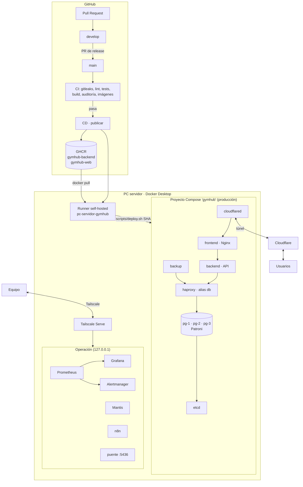
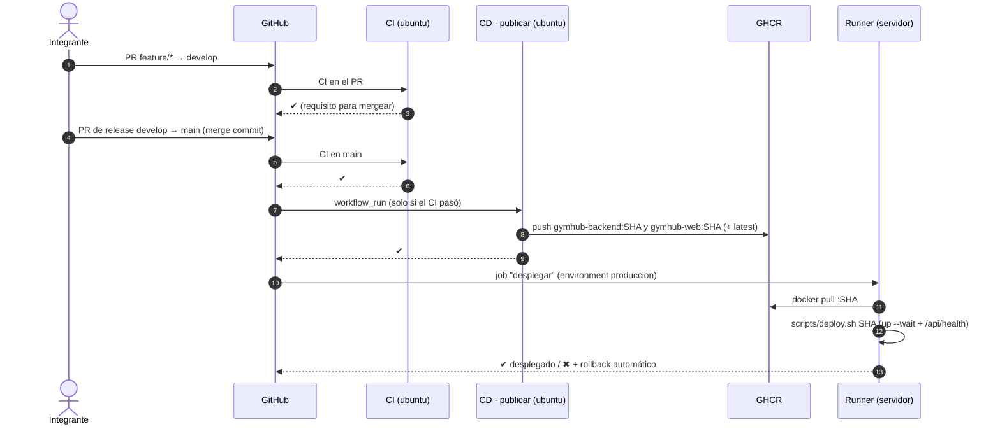

# GymHub en producción

Cómo está montado el entorno de producción de GymHub, cómo llega un cambio desde el código hasta los usuarios, cómo se publica en Internet, cómo se administra y qué hacer cuando algo falla.

> **Ningún secreto está en este documento ni en el repositorio.** Donde aparece una credencial se indica *en qué archivo del servidor* está, nunca su valor.

---

## Índice

1. [Resumen en una página](#1-resumen-en-una-página)
2. [Arquitectura](#2-arquitectura)
3. [El servidor](#3-el-servidor)
4. [Contenedores de producción](#4-contenedores-de-producción)
5. [Redes, volúmenes y aislamiento de desarrollo](#5-redes-volúmenes-y-aislamiento-de-desarrollo)
6. [Configuración y secretos](#6-configuración-y-secretos)
7. [Del commit a producción: CI/CD](#7-del-commit-a-producción-cicd)
8. [Cómo se despliega una versión (`scripts/deploy.sh`)](#8-cómo-se-despliega-una-versión-scriptsdeploysh)
9. [Rollback](#9-rollback)
10. [Publicación en Internet: Cloudflare Tunnel](#10-publicación-en-internet-cloudflare-tunnel)
11. [Acceso administrativo: Tailscale](#11-acceso-administrativo-tailscale)
12. [Base de datos: replicación, acceso y backups](#12-base-de-datos-replicación-acceso-y-backups)
13. [Monitoreo y alertas](#13-monitoreo-y-alertas)
14. [Incidencias y automatización (Mantis y n8n)](#14-incidencias-y-automatización-mantis-y-n8n)
15. [Seguridad: qué está expuesto y por qué](#15-seguridad-qué-está-expuesto-y-por-qué)
16. [Operación diaria: comandos](#16-operación-diaria-comandos)
17. [Montar el servidor desde cero](#17-montar-el-servidor-desde-cero)
18. [Checklist del día de la defensa](#18-checklist-del-día-de-la-defensa)
19. [Solución de problemas](#19-solución-de-problemas)
20. [Limitaciones conocidas](#20-limitaciones-conocidas)
21. [Documentación relacionada](#21-documentación-relacionada)

---

## 1. Resumen en una página

- **Dónde corre:** una PC de escritorio con Windows 11 y Docker Desktop, que hace de servidor.
- **Qué corre:** frontend (Nginx + Angular), backend (Node/Express), cluster PostgreSQL con failover automático (Patroni: 1 líder + 2 réplicas), backups automáticos, monitoreo (Prometheus, Grafana, Alertmanager y exporters), Mantis, n8n y el túnel de Cloudflare.
- **Cómo llega un cambio:** PR a `develop` → PR de release a `main` → el **CI** valida → el **CD** publica las imágenes en GHCR y un **runner instalado en el servidor** las despliega. Si la versión nueva no está sana, se vuelve sola a la anterior.
- **Cómo entra el público:** por **Cloudflare Tunnel**, una URL HTTPS que llega solo al Nginx. El router no tiene puertos abiertos.
- **Cómo entra el equipo a administrar:** por **Tailscale**, una VPN privada. Grafana, Prometheus, Mantis, n8n y la base solo son accesibles desde los dispositivos del equipo.
- **La base de datos no se publica nunca:** ni a Internet ni a la red local.

```
                ┌────────── Internet ──────────┐            ┌──── Equipo (Tailscale) ────┐
                │  https://….trycloudflare.com │            │  notebook / celular        │
                └──────────────┬───────────────┘            └─────────────┬──────────────┘
                               │ HTTPS                                    │ WireGuard (cifrado)
                         ┌─────▼──────┐                                   │
                         │ Cloudflare │                                   │
                         └─────▲──────┘                                   │
                               │ túnel saliente                           │
  ┌────────────────────────────┼──── PC servidor (Docker) ────────────────┼───────────────────┐
  │                      ┌─────┴──────┐                            ┌──────▼───────┐           │
  │                      │cloudflared │                            │Tailscale Serve│          │
  │                      └─────┬──────┘                            └──────┬───────┘           │
  │                            ▼                                          ▼ (127.0.0.1)       │
  │                   ┌─────────────────┐           Grafana · Prometheus · Alertmanager       │
  │                   │ Nginx (frontend)│           Mantis · n8n · puente a la base           │
  │                   └────────┬────────┘                                 │                   │
  │                            ▼ /api                                     │                   │
  │                   ┌─────────────────┐                                 │                   │
  │                   │ Backend (API)   │                                 │                   │
  │                   └───┬─────────┬───┘                                 │                   │
  │              escrituras│         │lecturas                            │                   │
  │                   ┌────▼───┐ WAL ┌▼────────┐                          │                   │
  │                   │Primario├────►│ Réplica │◄─────────────────────────┘                   │
  │                   └────┬───┘     └─────────┘                                              │
  │                        ▼ pg_dump diario                                                   │
  │                   [ backups ]                                                             │
  └───────────────────────────────────────────────────────────────────────────────────────────┘
```

---

## 2. Arquitectura



---

## 3. El servidor

| Aspecto | Valor |
|---|---|
| Equipo | PC de escritorio del integrante Francisco Paredes |
| Sistema | Windows 11 Home, Docker Desktop (motor Linux en WSL2) |
| Nombre en Tailscale | `gymhub-servidor` (`gymhub-servidor.tailec3350.ts.net`) |
| Runner de GitHub Actions | `pc-servidor-gymhub`, label `gymhub`, instalado en `C:\actions-runner` |
| Carpeta de estado de producción | `produccion/` del proyecto (secretos, credenciales, versión desplegada e historial; ignorada por Git salvo `produccion/LEEME.md`) |
| Repositorio local | carpeta del proyecto clonado (lo usan `scripts/infra.sh` y el puente) |

**Por qué una PC personal y no la nube:** el enunciado permite *"servidor local con túnel seguro"*, el equipo no tiene costo de hosting y se demuestra el circuito completo (CI/CD, túnel, VPN, monitoreo). Las desventajas están en la [sección 20](#20-limitaciones-conocidas).

---

## 4. Contenedores de producción

### 4.1 Los grupos en Docker Desktop

Los contenedores de GymHub se organizan en **tres grupos** (proyectos de Docker Compose). Docker Desktop los muestra como grupos plegables, cada uno con una responsabilidad:

```
Docker Desktop
├── gymhub-produccion      9 contenedores   lo que ven los usuarios
│   ├── gymhub_frontend_prod          Nginx + SPA de Angular
│   ├── gymhub_backend_prod           API Express
│   ├── gymhub_pg_1_prod       ┐
│   ├── gymhub_pg_2_prod       │      cluster PostgreSQL con Patroni:
│   ├── gymhub_pg_3_prod       │      1 líder + 2 réplicas, failover automático
│   ├── gymhub_etcd_prod       │      (etcd: quién es el líder;
│   ├── gymhub_haproxy_prod    ┘       HAProxy "db": manda al líder)
│   ├── gymhub_backup_prod            pg_dump diario
│   └── gymhub_cloudflared_rapido     túnel hacia Internet
│
├── gymhub-monitoreo       7 contenedores   observar producción
│   ├── gymhub-prometheus-scrum66, gymhub-grafana-scrum66, gymhub-alertmanager-scrum68
│   └── exporters: node, cAdvisor, blackbox, postgres (líder); Patroni expone sus propias métricas
│
├── gymhub-herramientas    4 contenedores   operar y administrar
│   ├── gymhub-mantis, gymhub-mantis-db     incidencias
│   ├── gymhub-n8n-scrum75                  automatización
│   └── gymhub_db_puente                    acceso a la base de producción (127.0.0.1:5436)
│
└── proyecto_demo_hia      entorno de DESARROLLO (cluster demo_hia_pg_1..3, etcd y HAProxy de desarrollo), aparte
```

| Grupo | Lo levanta | Archivos |
|---|---|---|
| `gymhub-produccion` | El **CD** (`scripts/deploy.sh`) en cada merge a `main` | `compose.yaml` + `compose.prod.yaml` + `compose.tunnel.yaml` |
| `gymhub-monitoreo` | `bash scripts/infra.sh levantar` | `infra/monitoring/docker-compose.yml` + `docker-compose.prod.yml` |
| `gymhub-herramientas` | `bash scripts/infra.sh levantar` | `infra/mantis/`, `infra/n8n/` e `infra/admin/` (los tres declaran `name: gymhub-herramientas`) |

Criterios del agrupamiento:

- **Por ciclo de vida:** producción cambia con cada despliegue; monitoreo y herramientas casi nunca. Un despliegue no reinicia Grafana ni Mantis, y bajar las herramientas no toca la app.
- **Por responsabilidad:** lo que ven los usuarios, lo que mira el equipo y lo que usa el equipo para operar.
- **Cluster de base dentro de producción:** los 3 nodos Patroni, etcd y HAProxy viven en el mismo grupo que la app porque se despliegan juntos y comparten la red interna `gymhub_prod_db_net`.
- **Nombres de contenedor:** se conservaron los que eligió cada integrante (por ejemplo `-scrum66`), porque los referencian scripts y documentación de su ticket. El grupo los ordena sin romper nada.
- **Datos intactos:** al renombrar los grupos, los volúmenes conservan su nombre original (`gymhub-scrum66_*`, `gymhub-scrum75_n8n_data`, `gymhub_mantis_db`, `gymhub_prod_*`), declarado explícitamente en cada compose.

### 4.2 Detalle del grupo `gymhub-produccion`

Proyecto Compose **`gymhub-produccion`**, definido por `compose.yaml` + `compose.prod.yaml` + `compose.tunnel.yaml`.

| Contenedor | Imagen | Qué hace | Puerto en el host |
|---|---|---|---|
| `gymhub_frontend_prod` | `ghcr.io/valentiniriar/gymhub-web:<SHA>` | Nginx sin privilegios: sirve la SPA de Angular y hace de proxy de `/api` hacia el backend | `127.0.0.1:80` |
| `gymhub_backend_prod` | `ghcr.io/valentiniriar/gymhub-backend:<SHA>` | API Express (Node 22, usuario no root). Escribe en `db:5432` (líder) y lee de `db:5433` (réplicas) | — |
| `gymhub_pg_1_prod`, `gymhub_pg_2_prod`, `gymhub_pg_3_prod` | `gymhub-patroni:16` (local, `database/patroni/`) | Nodos PostgreSQL 16 con Patroni: uno es líder y dos réplicas por streaming; si cae el líder, Patroni promueve otro solo. Configuración en `database/patroni/patroni.yml` y `database/config/postgresql.conf` | — |
| `gymhub_etcd_prod` | `quay.io/coreos/etcd:v3.5.21` | Guarda quién es el líder (lock con vencimiento de 20 s) | — |
| `gymhub_haproxy_prod` | `haproxy:3.2.4-alpine` | Alias de red `db`: `db:5432` → líder, `db:5433` → lecturas. Pregunta a la API de Patroni (`:8008`) quién es quién | — |
| `gymhub_backup_prod` | `gymhub-backup` (local) | `pg_dump` diario a las 03:00, retención de 7 días | — |
| `gymhub_cloudflared_rapido` | `cloudflare/cloudflared:2026.10.7@sha256:…` | Túnel hacia Cloudflare (sistema de archivos de solo lectura, sin capacidades) | `127.0.0.1:2000` (métricas) |

Las imágenes de la app se etiquetan con el **SHA del commit** que las generó: cada versión es inmutable y se puede volver a cualquiera.

**Healthchecks:**

- `pg-1..3`: `GET /health` de la API de Patroni (200 si PostgreSQL corre en ese nodo, sea líder o réplica).
- `backend`: `HEALTHCHECK` de la imagen sobre `GET /api/health`, que responde 200 solo si la API y la base funcionan.
- El despliegue además verifica `http://127.0.0.1/api/health` **pasando por Nginx** (ver [sección 8](#8-cómo-se-despliega-una-versión-scriptsdeploysh)).

---

## 5. Redes, volúmenes y aislamiento de desarrollo

En la misma PC conviven el entorno de **desarrollo** (contenedores `demo_hia_*`, proyecto `proyecto_demo_hia`) y el de **producción**. Producción usa nombres propios para no compartir nada con desarrollo:

| Recurso | Producción | Contiene |
|---|---|---|
| Red `gymhub_prod_frontend_net` | frontend, backend, cloudflared, exporters web | Tráfico web |
| Red `gymhub_prod_db_net` | backend, haproxy (`db`), pg-1..3, etcd, backup, Prometheus, exporter de Postgres, puente | Tráfico de base de datos |
| Volumen `gymhub_prod_db_data` | — | Datos de `pg-1` (el volumen del antiguo primario, adoptado por Patroni) |
| Volúmenes `gymhub_prod_db_replica_data`, `gymhub_prod_db_replica2_data` | — | Datos de `pg-2` y `pg-3` |
| Volumen `gymhub_prod_etcd_data` | — | Estado de etcd (quién es el líder) |
| Volumen `gymhub_prod_db_backups` | — | Archivos de backup |

- **El frontend no está en la red de la base:** aunque se comprometiera Nginx, no llega directo a PostgreSQL.
- **Recrear contenedores no borra datos:** los datos viven en los volúmenes. Solo `docker volume rm` los elimina.
- **La base de producción nunca usa la de desarrollo:** son volúmenes distintos. Lo garantiza `compose.prod.yaml`.

---

## 6. Configuración y secretos

**Todo está dentro de la carpeta del proyecto.** Los secretos de producción viven en `produccion/`, que Git ignora salvo su `LEEME.md`. Los de cada herramienta viven junto a su compose, también ignorados.

```
proyecto_demo_hia/
├── produccion/                         ← secretos y estado del servidor (ignorada por Git)
│   ├── LEEME.md                        ← único archivo versionado: explica la carpeta
│   ├── .env.prod
│   ├── credenciales-produccion.txt
│   ├── CREDENCIALES.txt                ← TODAS las credenciales juntas (bash scripts/infra.sh credenciales)
│   ├── version-desplegada.txt
│   └── historial-despliegues.log
└── infra/
    ├── monitoring/.env
    ├── mantis/.env, mantis/credenciales.local.json
    └── n8n/.env
```

| Archivo | Contenido | ¿En Git? |
|---|---|---|
| `produccion/.env.prod` | `DB_NAME`, `DB_USER`, `DB_PASS`, `POSTGRES_REPLICA_PASSWORD`, `JWT_SECRET`, configuración de backups, token opcional del túnel con nombre | **No** |
| `produccion/credenciales-produccion.txt` | Contraseñas de `admin@demo.com` y `entrenador@demo.com` en producción | **No** |
| `produccion/CREDENCIALES.txt` | Todas las credenciales (app, base, Grafana, Mantis, n8n, túnel) en un solo archivo. Se regenera con `bash scripts/infra.sh credenciales` | **No** |
| `produccion/version-desplegada.txt` | SHA de la versión en producción | **No** |
| `produccion/historial-despliegues.log` | Historial de despliegues y rollbacks | **No** |
| `infra/monitoring/.env` | Puertos, contraseña de Grafana, usuario de métricas `gymhub_monitor` | **No** (`.gitignore`) |
| `infra/mantis/.env`, `infra/mantis/credenciales.local.json` | Claves de Mantis y credenciales iniciales | **No** (`.gitignore`) |
| `infra/n8n/.env` | Puerto y clave de cifrado de n8n | **No** (`.gitignore`) |

**Principios:**

- **GitHub no conoce ningún secreto de producción:** el pipeline solo usa el `GITHUB_TOKEN` efímero que crea cada ejecución.
- **Secretos aleatorios:** todos se generaron con `crypto.randomBytes`; ninguno es una contraseña de ejemplo.
- **Usuarios de prueba:** la contraseña `demo1234` que figura en el README **ya no vale en producción** para `admin` ni `entrenador`. Solo `socio@demo.com` la conserva, como cuenta pública de demostración.
- **Escaneo de secretos:** el CI corre **gitleaks** sobre todo el historial en cada PR. Si alguien sube un secreto, el PR queda en rojo.

**Si se filtra un secreto:** rotarlo primero (por ejemplo, cambiar `JWT_SECRET` en `.env.prod` y redesplegar) y recién después limpiar el historial. Borrar el commit no alcanza.

---

## 7. Del commit a producción: CI/CD



### 7.1 CI (`.github/workflows/ci.yml`)

Corre en cada PR y en cada push a `develop` y `main`:

| Job | Qué verifica |
|---|---|
| Escaneo de secretos | gitleaks sobre todo el historial (imagen fijada por digest) |
| Backend | `npm ci`, sintaxis de todos los `.js`, ESLint, tests, `npm audit --omit=dev --audit-level=high` |
| Frontend | `npm ci`, build de producción, tests unitarios, auditoría de dependencias |
| Docker | Build de las imágenes del backend y del frontend |

Las acciones están **fijadas por SHA** y el workflow tiene permisos mínimos (`permissions: {}`), dos mitigaciones contra ataques a la cadena de suministro.

### 7.2 CD (`.github/workflows/cd.yml`)

| Job | Dónde corre | Qué hace |
|---|---|---|
| `publicar` | `ubuntu-latest` (GitHub) | Solo si el CI de `main` pasó. Construye el **mismo commit** que validó el CI y publica `gymhub-backend` y `gymhub-web` en GHCR con el tag = SHA y `latest`. |
| `desplegar` | **Runner self-hosted** del servidor | Environment `produccion`. Descarga las imágenes y ejecuta `scripts/deploy.sh <SHA>`. |

**¿Por qué un runner en el servidor y no SSH?** El runner abre una conexión *saliente* hacia GitHub y espera trabajos. No hace falta exponer SSH ni abrir puertos, igual que con el túnel.

**¿Por qué el frontend se llama `gymhub-web` en GHCR?** El paquete `gymhub-frontend` ya existía en la cuenta sin vínculo con el repositorio, y el `GITHUB_TOKEN` no puede escribir en él. Con un nombre nuevo, el workflow lo crea vinculado al repo.

### 7.3 Reglas del flujo

- Nadie despliega a mano en el día a día: **se despliega mergeando a `main`**.
- Los releases `develop → main` usan **merge commit**, no squash, para que las dos ramas compartan historia.
- Un despliegue por vez (`concurrency: cd-produccion`): si llegan dos, el segundo espera.

---

## 8. Cómo se despliega una versión (`scripts/deploy.sh`)

```bash
bash scripts/deploy.sh <SHA>     # despliega esa versión
bash scripts/deploy.sh --estado  # versión actual + últimos 10 despliegues
bash scripts/deploy.sh --tunel   # levanta el túnel rápido sin tocar la app
```

Pasos de un despliegue:

1. Lee la versión actual de `produccion/version-desplegada.txt` (para un eventual rollback).
2. `docker compose pull` de `gymhub-backend:<SHA>` y `gymhub-web:<SHA>`.
3. `docker compose up -d --wait` de `etcd`, `pg-1`, `pg-2`, `pg-3`, `haproxy`, `backup`, `backend` y `frontend`, con `IMAGE_TAG=<SHA>`. El `--wait` espera a que todos los servicios con healthcheck estén *healthy* (máximo 240 s). **El túnel no se recrea**, para que no cambie la URL pública.
4. Verificación de punta a punta: `http://127.0.0.1/api/health` tiene que responder **200 pasando por Nginx** (frontend → backend → base).
5. Si todo está bien, escribe el SHA en `version-desplegada.txt` y una línea `OK` en el historial.
6. Si algo falla, hace un **rollback automático** a la versión anterior, lo verifica de la misma forma y termina con error para que el job quede en rojo.

Ejemplo de historial real:

```
2026-11-18 17:46:28 | 6eaa021321049eebe0ef003fccfeb6a40722cf23 | OK
2026-11-18 17:54:03 | 967f238a0a799358e4eeb8703e71fc736e0f65d8 | OK
2026-11-18 17:55:02 | 6eaa021321049eebe0ef003fccfeb6a40722cf23 | OK      ← rollback manual
2026-11-18 17:56:00 | 967f238a0a799358e4eeb8703e71fc736e0f65d8 | OK      ← vuelta a la versión actual
```

---

## 9. Rollback

| Situación | Qué hacer | Tiempo |
|---|---|---|
| La versión nueva no pasa el chequeo de salud | **Nada**: `deploy.sh` vuelve sola a la versión anterior | ~10 s |
| La versión nueva funciona pero tiene un error funcional | GitHub → *Actions* → *CD* → *Run workflow* (rama `main`) → `tag` = SHA completo de la versión anterior | ~1 min |
| GitHub no está disponible | En el servidor: `bash scripts/deploy.sh <SHA anterior>` | ~30 s |
| Hay que revertir el código en `main` | `git revert` del commit, PR a `develop` y release a `main`; el CD despliega la versión revertida | Lo que tarde el PR |

Para obtener el SHA completo de una versión: `git log main --format='%H %s'`, o la pestaña *Packages* del repositorio en GitHub.

**El rollback revierte las imágenes, no los datos.** Si un cambio modificó el esquema de la base de forma incompatible, hay que restaurar un backup ([sección 12.3](#123-backups)).

Las pruebas de rollback automático y manual están documentadas con evidencia en `docs/SCRUM-57-despliegue-continuo.md`.

---

## 10. Publicación en Internet: Cloudflare Tunnel

### 10.1 El problema

Desde Internet no se puede llegar a una PC hogareña: tiene IP privada (`192.168.x.x`), el router bloquea lo que entra y la IP pública cambia. La solución clásica (abrir el puerto 80 en el router) expone la PC directamente.

### 10.2 Cómo lo resuelve el túnel

1. El contenedor `cloudflared` **sale** hacia Cloudflare y mantiene una conexión abierta. Para el router es tráfico de salida, que siempre está permitido.
2. Cloudflare asigna una URL con **HTTPS** y certificado válido.
3. Cuando un usuario entra a la URL, Cloudflare envía el pedido **por esa conexión ya abierta** hasta `cloudflared`.
4. `cloudflared` lo entrega a `frontend:8080` (Nginx) por la red interna de Docker. Nginx sirve la SPA y reenvía `/api` al backend.

**Solo se publica Nginx.** No hay regla de ingreso hacia la base, Grafana, Mantis ni n8n. Cloudflare además aporta protección básica contra DDoS.

### 10.3 Tres modos

| Modo | Comando | URL | Uso |
|---|---|---|---|
| **Tailscale Funnel** (principal) | `bash scripts/tailscale-serve.sh` | **`https://gymhub-servidor.tailec3350.ts.net`**, **fija**: no cambia al reiniciar | Gratis, sin dominio. Solo publica la app (`127.0.0.1:80`); lo administrativo sigue solo en la tailnet. Se habilita una vez en la tailnet |
| **Túnel rápido** (respaldo) | `bash scripts/deploy.sh --tunel` | `https://<palabras-al-azar>.trycloudflare.com`. **Cambia** al reiniciar `cloudflared` o la PC | Demo, sin cuenta ni dominio |
| **Túnel con nombre** | perfil `tunel` + `CLOUDFLARE_TUNNEL_TOKEN` en `.env.prod` | `https://gymhub.<dominio>`, **fija** | Requiere un dominio en Cloudflare (`docs/SCRUM-60-cloudflare-tunnel.md`) |

Para ver la URL actual del túnel rápido: `bash scripts/infra.sh estado`, o `docker logs gymhub_cloudflared_rapido 2>&1 | grep trycloudflare`.

**Funnel:** el tráfico llega a un relay de Tailscale y viaja cifrado hasta `tailscaled` en el servidor, que lo entrega a `127.0.0.1:80` (Nginx). Funciona aunque Docker se reinicie, pero necesita que la PC esté prendida y con Tailscale conectado (servicio de Windows, arranca solo). Estado: `tailscale funnel status`. Apagarlo: `tailscale funnel --https=443 off`.

---

## 11. Acceso administrativo: Tailscale

### 11.1 Qué es

Tailscale arma una **red privada cifrada (WireGuard)** entre los dispositivos que inician sesión con la misma cuenta. La PC servidor aparece como `gymhub-servidor`, sin importar dónde esté cada dispositivo. Igual que el túnel, no abre puertos en el router.

### 11.2 Cómo se publican los paneles

Todos los servicios de operación escuchan **solo en `127.0.0.1`** del servidor. `scripts/tailscale-serve.sh` usa **Tailscale Serve** para reenviar cada puerto **solo en la interfaz de Tailscale** hacia `127.0.0.1`:

| Servicio | En el servidor | Desde la tailnet |
|---|---|---|
| App de producción | http://127.0.0.1/ | http://gymhub-servidor.tailec3350.ts.net/ |
| Grafana | http://127.0.0.1:3001/ | http://gymhub-servidor.tailec3350.ts.net:3001/ |
| Prometheus | http://127.0.0.1:9091/ | http://gymhub-servidor.tailec3350.ts.net:9091/ |
| Alertmanager | http://127.0.0.1:9093/ | http://gymhub-servidor.tailec3350.ts.net:9093/ |
| Mantis | http://127.0.0.1:8990/ | http://gymhub-servidor.tailec3350.ts.net:8990/ |
| n8n | http://127.0.0.1:5679/ | http://gymhub-servidor.tailec3350.ts.net:5679/ |
| Base de producción | `127.0.0.1:5436` | `gymhub-servidor.tailec3350.ts.net:5436` |

Verificado: por la tailnet todos responden; por la red local (`192.168.100.12`) **ninguno**.

### 11.3 Sumar un dispositivo

1. Instalar Tailscale ([tailscale.com/download](https://tailscale.com/download)).
2. Iniciar sesión con la cuenta de la tailnet (o aceptar la invitación si se comparte con el equipo).
3. Abrir cualquiera de las URL de la tabla.

Si se pierde un dispositivo, se lo quita desde el panel de Tailscale y pierde el acceso al instante.

---

## 12. Base de datos: replicación, acceso y backups

### 12.1 Replicación

- **Configuración:** cluster **Patroni** de 3 nodos (`pg-1`, `pg-2`, `pg-3`) con **replicación física por streaming asíncrona**; Patroni crea y borra los replication slots. etcd guarda quién es el líder y HAProxy (`db`) manda las conexiones a él.
- **Reparto de la carga:** el backend escribe en `db:5432` (líder) y lee de `db:5433` (réplicas) (`DB_HOST_PRIMARY` / `DB_HOST_REPLICA`, Sequelize `replication`).
- **Réplica de solo lectura:** `pg_is_in_recovery() = true`.
- **Monitoreo:** Prometheus lee la API de Patroni de cada nodo: rol, atraso y cambios de líder (alertas `GymHubSinLider`, `GymHubFailoverOcurrido`, `GymHubNodoPatroniCaido`, etc.).
- **Failover automático:** si cae el líder, Patroni promueve una réplica en segundos y el viejo líder vuelve solo como réplica. Prueba, comandos y migración: **`docs/implementacion-patroni.MD`**. Ver el estado: `docker exec gymhub_pg_1_prod patronictl -c /etc/patroni/patroni.yml list`.

### 12.2 Cómo entrar a la base

**La base no publica puertos.** Hay tres formas de entrar:

| Desde | Cómo | Datos |
|---|---|---|
| El servidor, por consola | `docker exec -it gymhub_pg_1_prod sh -c 'PGPASSWORD="$PATRONI_SUPERUSER_PASSWORD" psql -h db -U "$PATRONI_SUPERUSER_USERNAME" -d "$DB_NAME"'` | Sin escribir la contraseña (la toma del contenedor). `-h db` va por HAProxy: siempre al líder |
| El servidor, con pgAdmin o DBeaver | Host `127.0.0.1`, puerto `5436`, base y usuario `gymhub` | Contraseña: `DB_PASS` de `produccion/.env.prod` |
| Otro dispositivo (Tailscale) | Host `gymhub-servidor.tailec3350.ts.net`, puerto `5436`, base y usuario `gymhub` | Ídem |

El puerto 5436 lo provee el **puente** (`infra/admin/docker-compose.yml`): un contenedor `socat` endurecido (solo lectura, sin capacidades) que reenvía `127.0.0.1:5436` → `db:5432` por la red interna.

> ⚠️ El usuario `gymhub` es **superusuario** de la base de producción. Usalo con cuidado y hacé un backup antes de modificar datos. Para pruebas está la base de **desarrollo** (`127.0.0.1:5434`).

Para monitoreo existe además el usuario **`gymhub_monitor`**, que solo tiene el rol `pg_monitor`: lee estadísticas, no datos.

### 12.3 Backups

| Aspecto | Valor |
|---|---|
| Servicio | `gymhub_backup_prod` (`database/backup/`) |
| Frecuencia | Todos los días a las 03:00 (`BACKUP_CRON_SCHEDULE`) y uno al arrancar |
| Formato | `pg_dump -F c` (formato *custom*, restaurable con `pg_restore`) |
| Retención | 7 días (`BACKUP_RETENTION_DAYS`) |
| Ubicación | Volumen `gymhub_prod_db_backups` → `/backups/gymhub_gymhub_<fecha>.dump`, con `latest.dump` apuntando al último |
| Registro | `/backups/backup.log` y `/backups/latest_status.json` |

Comandos:

```bash
# ver backups
MSYS_NO_PATHCONV=1 docker exec gymhub_backup_prod ls -la /backups

# backup manual ahora
MSYS_NO_PATHCONV=1 docker exec gymhub_backup_prod /scripts/backup.sh

# restaurar el último backup (¡reemplaza los datos actuales!)
MSYS_NO_PATHCONV=1 docker exec gymhub_backup_prod /scripts/restore.sh /backups/latest.dump
```

Procedimiento completo y prueba de restauración: `docs/SCRUM-38-persistencia-y-restauracion.md`.

> Los backups están en la misma PC que la base. Ante un ransomware o la rotura del disco se pierden los dos: conviene copiar periódicamente `latest.dump` a otro medio (ver [sección 20](#20-limitaciones-conocidas)).

---

## 13. Monitoreo y alertas

Se levanta con `bash scripts/infra.sh levantar`, que usa `infra/monitoring/docker-compose.yml` + `docker-compose.prod.yml`.

| Componente | Qué mide |
|---|---|
| node-exporter | CPU, memoria, disco y red del servidor (VM de Docker) |
| cAdvisor | Estado, recursos y reinicios de cada contenedor |
| postgres-exporter (del líder) + métricas de Patroni | Conexiones, transacciones y tamaño de la base; rol de cada nodo, atraso de las réplicas y cambios de líder |
| blackbox-exporter | Disponibilidad HTTP: `frontend:8080/api/health`, `backend:3000/api/health` y **la URL pública** (desde afuera, por Cloudflare) |
| cloudflared | Métricas del propio túnel |

- **Dashboard:** Grafana → *GymHub \| Producción*.
- **Alertas:** reglas en `prometheus/alerts/gymhub.rules.prod.yml` (app caída, nodo del cluster caído, sin líder, failover ocurrido, réplica atrasada, CPU, memoria, disco, reinicios de contenedores, URL pública caída, certificado por vencer).
- **Configuración derivada:** la configuración de producción se **genera** a partir de la del equipo con `bash infra/monitoring/generar-prod.sh`, que solo cambia los destinos. Si se modifica la configuración original, hay que volver a correrlo (`infra.sh levantar` lo hace solo).

---

## 14. Incidencias y automatización (Mantis y n8n)

| Herramienta | Para qué | Acceso |
|---|---|---|
| **Mantis** | Registro y seguimiento de incidencias (proyecto GymHub, categorías y prioridades del equipo) | http://127.0.0.1:8990/ o por Tailscale. Credenciales en `infra/mantis/credenciales.local.json` |
| **n8n** | Flujos: alerta de Prometheus → incidencia en Mantis → notificación; verificación de backups; eventos de seguridad | http://127.0.0.1:5679/ o por Tailscale. La cuenta *owner* se crea en el primer ingreso |

- **Conexión entre ellos:** n8n habla con Mantis por la red interna `gymhub_tools_net` (`http://mantis/api/rest/...`).
- **Workflows:** están en `infra/n8n/workflows/`.
- **Enlaces de Mantis:** usa `MANTIS_PATH=auto`, así arma los enlaces con el host por el que se entra (localhost o Tailscale).

---

## 15. Seguridad: qué está expuesto y por qué

### 15.1 Superficie de exposición

| Servicio | Internet | Red local | Tailnet | Solo en el servidor |
|---|---|---|---|---|
| App (Nginx) | ✅ por Cloudflare | ❌ | ✅ | ✅ |
| Backend | ❌ (solo a través de Nginx) | ❌ | ❌ | ❌ (solo red interna) |
| Base de datos | ❌ | ❌ | ✅ por el puente | ✅ por el puente |
| Grafana, Prometheus, Alertmanager, Mantis, n8n | ❌ | ❌ | ✅ | ✅ |

### 15.2 Controles aplicados

| Amenaza | Control |
|---|---|
| Acceso directo a la base | Sin puertos publicados; redes internas separadas; puente solo en `127.0.0.1` |
| Escaneo y ataques a la IP de la casa | Ningún puerto abierto en el router (túnel y VPN salientes) |
| Tráfico interceptado | HTTPS con TLS 1.3 (Cloudflare) para el público; WireGuard para el equipo |
| DDoS básico | Cloudflare delante de la app; rate limiting en `/api/auth` |
| Robo de credenciales | Contraseñas aleatorias en producción; `demo1234` solo para el socio demo; bcrypt; JWT con secreto propio |
| Cabeceras y XSS | `helmet` en la API; CSP, `X-Frame-Options: DENY`, `nosniff` y HSTS en Nginx |
| Secretos en el repo | `.gitignore` + gitleaks en cada PR; secretos de producción solo en el servidor |
| Cadena de suministro | Acciones y túnel fijados por SHA o digest; Dependabot; `npm audit` en el CI |
| Contenedores comprometidos | Backend y Nginx sin root; túnel y puente sin capacidades y de solo lectura; límites de CPU y memoria |
| Despliegue defectuoso | CI obligatorio antes del CD; chequeo de salud y rollback automático |
| Acceso administrativo | Solo dispositivos de la tailnet, más el login propio de cada herramienta |

### 15.3 Puntos a mejorar

- El puente a la base usa un **superusuario**. Para administrar de forma remota conviene un usuario con permisos limitados.
- **Prometheus y Alertmanager no piden login** (solo son accesibles desde la tailnet). Desde Alertmanager se pueden silenciar alertas.
- **Tailscale da acceso a todos los paneles por igual.** Con ACL se puede limitar por persona.
- **Swagger (`/api/docs`) es público:** expone el mapa de la API, no datos.

---

## 16. Operación diaria: comandos

Ejecutar desde la carpeta del proyecto, en Git Bash.

| Tarea | Comando |
|---|---|
| Ver versión desplegada e historial | `bash scripts/deploy.sh --estado` |
| Ver los grupos, todos los accesos y si responden | `bash scripts/infra.sh estado` |
| Levantar `gymhub-monitoreo` y `gymhub-herramientas` | `bash scripts/infra.sh levantar` |
| Bajar `gymhub-monitoreo` y `gymhub-herramientas` | `bash scripts/infra.sh bajar` |
| Juntar todas las credenciales en `produccion/CREDENCIALES.txt` | `bash scripts/infra.sh credenciales` |
| Publicar la app en Internet (túnel rápido) | `bash scripts/deploy.sh --tunel` |
| Publicar los paneles en la tailnet | `bash scripts/tailscale-serve.sh` |
| Quitar los paneles de la tailnet | `bash scripts/tailscale-serve.sh --quitar` |
| Desplegar o volver a una versión a mano | `bash scripts/deploy.sh <SHA completo>` |
| Logs de la API | `docker logs -f gymhub_backend_prod` |
| Logs de Nginx | `docker logs -f gymhub_frontend_prod` |
| Contenedores de un grupo | `docker ps --filter label=com.docker.compose.project=gymhub-produccion` (o `-monitoreo`, `-herramientas`) |
| Consola SQL | `docker exec -it gymhub_pg_1_prod sh -c 'PGPASSWORD="$PATRONI_SUPERUSER_PASSWORD" psql -h db -U "$PATRONI_SUPERUSER_USERNAME" -d "$DB_NAME"'` |
| Arrancar el runner del CD | `C:\actions-runner\iniciar-runner.cmd` |

---

## 17. Montar el servidor desde cero

Para reconstruir el servidor en otra PC:

1. **Instalar** Docker Desktop, Git para Windows (aporta Git Bash) y Node.js 22. Clonar el repositorio.
2. **Crear los secretos de producción** en `produccion/.env.prod` (variables en `docs/SCRUM-57-despliegue-continuo.md` §3.1, valores aleatorios con `node -e "console.log(require('crypto').randomBytes(32).toString('hex'))"`).
3. **Registrar el runner** (requiere al dueño del repo):
   - En GitHub: *Settings* → *Actions* → *Runners* → *New self-hosted runner* → Windows. Copiar el token.
   - En el servidor: `config.cmd --url https://github.com/valentiniriar/proyecto_demo_hia --token <TOKEN> --name pc-servidor-gymhub --labels gymhub --work _work --unattended`.
   - Copiar `infra/runner/iniciar-runner.cmd` a `C:\actions-runner\`.
   - Crear `C:\actions-runner\gymhub-env.cmd` (no versionado) con la ruta al `.env.prod` del proyecto, porque el job corre en la copia del repo del runner y no en la carpeta del proyecto:
     ```bat
     @echo off
     set "GYMHUB_ENV_FILE=C:/ruta/al/proyecto/produccion/.env.prod"
     ```
   - Ejecutar `C:\actions-runner\iniciar-runner.cmd`. Debe usarse este lanzador y no `run.cmd`, ver [sección 19](#19-solución-de-problemas).
4. **Primer despliegue:** GitHub → *Actions* → *CD* → *Run workflow* con el SHA de `main`, o mergear un release a `main`.
5. **Rotar los usuarios de prueba** `admin` y `entrenador` en la base de producción, y guardar sus contraseñas en `produccion/credenciales-produccion.txt`.
6. **Crear el usuario de métricas** `gymhub_monitor` con el rol `pg_monitor` y completar `infra/monitoring/.env` (`docs/SCRUM-61-acceso-administrativo.md` §2).
7. **Preparar Mantis:** `bash infra/mantis/setup.sh` y agregar `MANTIS_PATH=auto` en `infra/mantis/.env`.
8. **Preparar n8n:** crear `infra/n8n/.env` con `N8N_HOST_PORT=5679` y `N8N_ENCRYPTION_KEY`.
9. **Levantar la operación:** `bash scripts/infra.sh levantar`.
10. **Configurar Tailscale:** instalarlo, `tailscale up --hostname gymhub-servidor` y `bash scripts/tailscale-serve.sh`.
11. **Publicar la app:** `bash scripts/deploy.sh --tunel`.

---

## 18. Checklist del día de la defensa

En el servidor (en casa), antes de salir:

- [ ] PC encendida y **suspensión desactivada** (*Configuración → Sistema → Energía*).
- [ ] **Windows Update en pausa**, para que no se reinicie sola.
- [ ] Docker Desktop abierto.
- [ ] `bash scripts/deploy.sh --estado` → versión esperada, `OK`.
- [ ] `bash scripts/infra.sh levantar` → todo en ✔.
- [ ] `bash scripts/deploy.sh --tunel` → anotar la URL pública y probarla desde el celular con datos móviles.
- [ ] Runner corriendo (`C:\actions-runner\iniciar-runner.cmd`) si se va a mostrar un despliegue en vivo.
- [ ] Tailscale conectado, y `bash scripts/tailscale-serve.sh --estado` con los servicios publicados.

En la notebook que se lleva:

- [ ] Tailscale instalado y conectado a la misma tailnet. Probar Grafana y la base antes de salir.
- [ ] pgAdmin o DBeaver con la conexión `gymhub-servidor.tailec3350.ts.net:5436`.
- [ ] **Plan B:** repositorio clonado y Docker instalados, para levantar la app y un túnel desde la facultad si el servidor no responde.

---

## 19. Solución de problemas

| Síntoma | Causa | Solución |
|---|---|---|
| La URL fija (Funnel) no carga | PC apagada, sin Internet o Tailscale desconectado | `tailscale status` y `tailscale funnel status`; si falta, `bash scripts/tailscale-serve.sh` |
| La URL de Cloudflare no carga | El túnel rápido se reinició (cambió la URL) o Cloudflare lo dio de baja | `bash scripts/vigilar-tunel.sh --forzar` y usar la URL nueva |
| El runner se conecta pero muestra `Conflict` y no llega a "Listening for Jobs" | Quedó otra instancia del runner abierta, o GitHub todavía no liberó la sesión anterior | Cerrar todas las instancias (procesos `Runner.Listener` y los `cmd` de `iniciar-runner.cmd`), lanzar una sola y esperar unos minutos |
| `couldn't find env file: C:\c\Users\...` | Git Bash pasó a Docker una ruta `/c/...` | `deploy.sh` usa `pwd -W`; si se arma un comando a mano, usar rutas `C:/...` |
| El job *Desplegar* queda "esperando un runner" | El runner no está corriendo (por ejemplo, tras un reinicio) | Ejecutar `C:\actions-runner\iniciar-runner.cmd` |
| El job falla con `execvpe(/bin/bash) failed` | El runner usa el `bash.exe` de WSL | Arrancar el runner con `iniciar-runner.cmd`, que pone Git Bash primero en el `PATH` |
| *Publicar* falla con `denied` en GHCR | El paquete existe en la cuenta sin vínculo con el repo | Vincularlo (*Package settings* → *Manage Actions access* → *Write*) o publicar con otro nombre |
| `network ... was found but has incorrect label` | Una red de otro proyecto usa el mismo nombre | Producción usa redes `gymhub_prod_*` (`compose.prod.yaml`) |
| `port is already allocated` | Otro proyecto ocupa el puerto (por ejemplo el 9090) | Cambiar el puerto en el `.env` correspondiente (Prometheus usa 9091) |
| El despliegue termina en `ROLLBACK OK` | La versión nueva no pasó el chequeo de salud | `docker logs gymhub_backend_prod`, corregir y volver a mergear |
| Mantis carga sin estilos por Tailscale | Mantis arma los enlaces con `localhost` | `MANTIS_PATH=auto` en `infra/mantis/.env` y `bash scripts/infra.sh levantar` |
| Grafana sin datos de la base | Exporter sin usuario o contraseña | Revisar `PG_EXPORTER_*` en `infra/monitoring/.env` y el rol `gymhub_monitor` |
| pgAdmin no conecta al 5436 | El puente está apagado | `bash scripts/infra.sh levantar` |
| Git Bash cambia rutas como `/backups` por `C:/Program Files/Git/...` | Conversión de rutas de MSYS | Anteponer `MSYS_NO_PATHCONV=1` al comando |

---

## 20. Limitaciones conocidas

- **Un único servidor doméstico:** un corte de luz o de Internet, la suspensión o un reinicio de Windows dejan todo fuera de servicio. La disponibilidad se mide con `blackbox-publico`.
- **URL pública:** la URL fija es la de Funnel (`https://gymhub-servidor.tailec3350.ts.net`). El túnel rápido de Cloudflare queda de respaldo y cambia de dirección al reiniciarse. Un nombre propio (`gymhub.<dominio>`) requiere comprar un dominio y usar el túnel con nombre.
- **Failover automático, pero en un solo servidor:** Patroni cubre la caída de un nodo (contenedor), no la del servidor entero. Hay un solo etcd: si se cae, no puede haber failover hasta que vuelva (el líder sigue escribiendo gracias a `failsafe_mode`).
- **El rollback no revierte datos:** los cambios de esquema incompatibles requieren restaurar un backup.
- **Backups en el mismo disco:** no protegen contra ransomware ni contra la rotura del disco. Mejora: copia periódica fuera del servidor.
- **Runner y túnel se lanzan a mano** después de un reinicio. Mejora: tareas programadas al iniciar sesión.
- **Superusuario en el puente** y **paneles sin login propio** (Prometheus, Alertmanager), mitigados porque solo son accesibles por la tailnet.

---

## 21. Documentación relacionada

| Tema | Documento |
|---|---|
| Despliegue continuo, runner y rollback | `docs/SCRUM-57-despliegue-continuo.md` |
| Acceso administrativo por Tailscale y monitoreo de producción | `docs/SCRUM-61-acceso-administrativo.md` |
| Cloudflare Tunnel (túnel rápido y con nombre) | `docs/SCRUM-60-cloudflare-tunnel.md` |
| Compose de desarrollo y producción | `docs/SCRUM-53-compose-dev-prod.md` |
| Replicación, failover y recuperación | `docs/implementacion-patroni.MD` (actual) · `docs/SCRUM-45…49-*.md` (diseño anterior, failover manual) |
| Backups y restauración | `docs/SCRUM-37`, `docs/SCRUM-38-persistencia-y-restauracion.md` |
| Monitoreo, dashboard y alertas | `docs/11-manual-monitoreo-gymhub.md`, `docs/SCRUM-66/67/68-*.md` |
| Seguridad e informe de amenazas | `docs/14-informe-seguridad.md`, `docs/SCRUM-63-matriz-amenazas.md` |
| Flujo de trabajo del equipo | `CONTRIBUTING.md` |
| Diagnóstico y arquitectura inicial | `docs/01-diagnostico/` |
