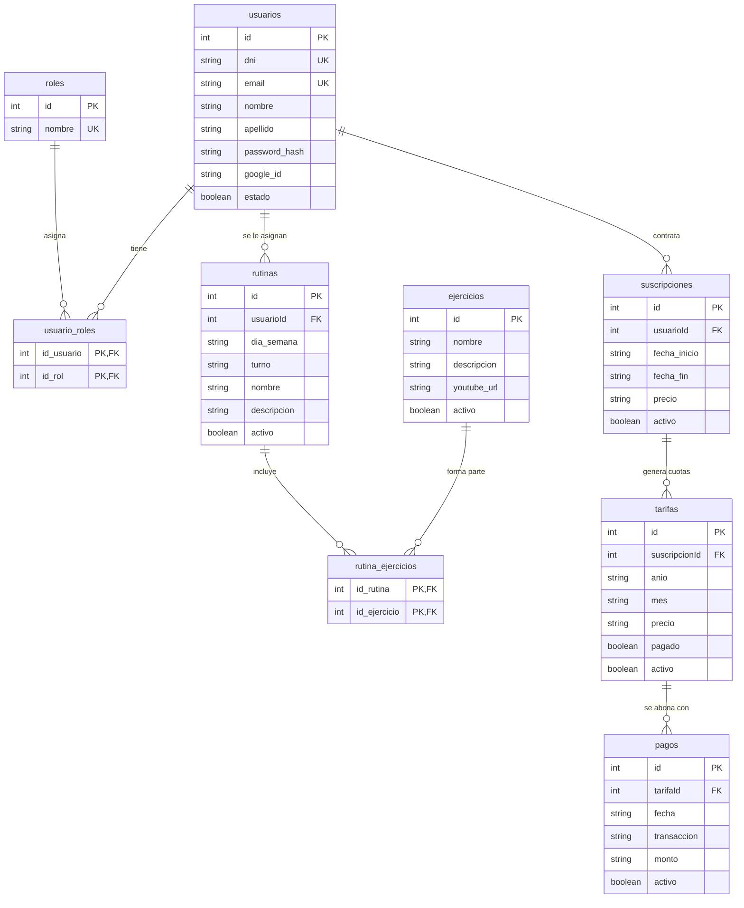

# Proyecto Demo HIA — GymHub

> **Práctica Integradora Final**  
> Aplicación web integral para la gestión de gimnasios (socios, rutinas asistidas por IA, cuotas y pagos).  
> Arquitectura contenerizada con frontend en Angular, backend en Node.js/Express y clúster de alta disponibilidad en PostgreSQL 16.

---

## 1. Requisitos Previos

Para ejecutar el proyecto en cualquier entorno limpio (Windows 11 / macOS / Linux) se requiere:
- **Docker Desktop** (con Docker Compose v2.20+ habilitado).
- **Node.js** v20 o superior y **npm** v10+ (solo necesario si se desea desarrollo local fuera de contenedores).
- **Git**.

---

## 2. Configuración Inicial de Entorno

El proyecto incluye plantillas con valores listos para usar en desarrollo:

```bash
# 1. Clonar el repositorio
git clone https://github.com/valentiniriar/proyecto_demo_hia.git
cd proyecto_demo_hia

# 2. Configurar variables de entorno generales
cp .env.example .env

# 3. Configurar variables de entorno del backend
cp backend/.env.example backend/.env
```

> [!NOTE]
> En `backend/.env` se debe definir una clave aleatoria para `JWT_SECRET` (ej: `JWT_SECRET=gymhub_secret_key_super_segura_123456`). Las claves de servicios externos (MercadoPago, Google OAuth, Groq, YouTube) son opcionales para la ejecución base del sistema.

`DB_NAME`, `DB_USER`, `DB_PASS`, `PGADMIN_DEFAULT_EMAIL` y `PGADMIN_DEFAULT_PASSWORD` son **obligatorias** en `.env` (no versionado): si falta alguna, `docker compose` falla con un mensaje y no arranca. Si tu `.env` es anterior, copiá las variables `PGADMIN_*` desde `.env.example`.

Perfiles disponibles en [`docker-compose.yml`](docker-compose.yml):

| Perfil | Comando | Servicio | Puerto en el host |
|---|---|---|---|
| `dev` | `docker compose --profile dev up -d` | `db-dev` | `localhost:${DB_PORT:-5433}` |
| `deploy` | `docker compose --profile deploy up -d` | `db` | Ninguno: solo se accede por la red interna `gymhub_db_net` (host `db`) |
| `tools` | se agrega al perfil elegido, p. ej. `docker compose --profile dev --profile tools up -d` | `pgadmin` | `127.0.0.1:${PGADMIN_PORT:-5050}` |
| `adminer` | se agrega al perfil elegido, p. ej. `docker compose --profile dev --profile adminer up -d` | `adminer` | `127.0.0.1:8080` |

- No levantes `dev` y `deploy` a la vez: comparten el volumen `db_data`.
- Estado y healthcheck: `docker compose --profile dev ps` tiene que mostrar `healthy`.
- Reiniciar desde cero (borra los datos): `docker compose --profile dev down -v && docker compose --profile dev up -d`
- pgAdmin 4 (http://127.0.0.1:5050): `docker compose --profile dev --profile tools up -d`. Espera a que la BD esté `healthy`. Se entra con `PGADMIN_DEFAULT_EMAIL` / `PGADMIN_DEFAULT_PASSWORD` del `.env`, y el servidor "GymHub PostgreSQL (db)" ya viene cargado (la contraseña es `DB_PASS`).
- Adminer, alternativa liviana (http://127.0.0.1:8080): `docker compose --profile dev --profile adminer up -d`
  (sistema: PostgreSQL · servidor: `db` · usuario/clave/base: los de tu `.env`)

## 3. Puesta en Marcha con Docker Compose

El proyecto cuenta con orquestación modular con redes y perfiles aislados.

### 3.1 Modo Desarrollo (Recomendado)
Levanta todos los servicios con hot-reload y puertos locales habilitados para debugging:

```bash
docker compose -f compose.yaml -f compose.dev.yaml up -d
```

**Servicios disponibles en desarrollo:**
- **Frontend SPA (Angular/Nginx):** [http://localhost:8080](http://localhost:8080)
- **API REST (Express):** [http://localhost:3000](http://localhost:3000)
- **Documentación Swagger:** [http://localhost:3000/api/docs](http://localhost:3000/api/docs)
- **PostgreSQL Primario:** `localhost:5433` (usuario: `demo_hia`, clave: `demo_hia_pass`, base: `demo_hia`)
- **pgAdmin 4 (Administración BD):** [http://localhost:5050](http://localhost:5050) (usuario: `admin@gymhub.com`, clave: `admin1234`)

### 3.2 Modo Clúster con Alta Disponibilidad y Replicación (E06)
Para desplegar el clúster completo con nodo réplica en Hot Standby por streaming físico:

```bash
docker compose -f compose.yaml -f compose.dev.yaml --profile cluster up -d
```
- **PostgreSQL Réplica (Solo Lectura):** `localhost:5434`

### 3.3 Modo Producción
En producción se utilizan imágenes inmutables de GHCR y **ningún puerto de base de datos se expone al exterior**:

```bash
docker compose -f compose.yaml -f compose.prod.yaml --profile prod up -d
```

---

## 4. Usuarios Demo Pre-cargados

El script inicial `database/02_seed.sql` genera automáticamente usuarios con distintos roles para pruebas (contraseña para todos: `admin123` o `123456` según el rol):

| Rol | Email | Uso / Permisos |
|---|---|---|
| **Administrador** | `admin@gymhub.com` | Gestión de socios, cobros, reportes globales y usuarios. |
| **Entrenador** | `entrenador@gymhub.com` | Creación y asignación de rutinas, generación asistida con IA. |
| **Socio** | `socio@gymhub.com` | Visualización de rutina personal, estado de cuota y pagos. |

---

## 5. Pruebas y Control de Calidad (CI)

Para ejecutar la suite de calidad en el backend:

```bash
cd backend
npm install
npm run lint         # Análisis estático de código con ESLint
npm test:ci          # Smoke tests unitarios y de integración de endpoints críticos
```

---

## 6. Resolución de Problemas Frecuentes (Troubleshooting)

1. **Conflicto con puerto 5432 preexistente:**
   - La base de datos de GymHub en desarrollo escucha en el puerto host `5433` precisamente para evitar colisiones con PostgreSQL locales.
2. **Reiniciar la base de datos desde cero:**
   ```bash
   docker compose down -v
   docker compose -f compose.yaml -f compose.dev.yaml up -d
   ```
3. **Verificar estado de salud de la API y conexión a BD:**
   - Consultar el endpoint de healthcheck: `curl http://localhost:3000/api/health` (debe devolver `{ "status": "ok", "db": "up" }`).

## Usuarios de prueba

Cargados por `database/02_seed.sql` (**solo desarrollo**). Contraseña de los tres: `demo1234`

| Rol | Email |
|---|---|
| admin | admin@demo.com |
| entrenador | entrenador@demo.com |
| socio | socio@demo.com |

## Modelo de datos



Todas las tablas (salvo `roles`, `usuario_roles` y `rutina_ejercicios`) tienen además `createdAt` y `updatedAt`.

El backend mantiene `sequelize.sync()` al arrancar: si una tabla no existe la crea, pero **no modifica** las existentes. Si se cambia un modelo de Sequelize, hay que reflejar el cambio en `database/01_schema.sql` y recrear la base (`docker compose --profile dev down -v`).

## Notas para el equipo

- **Nunca subir `.env`** (está en `.gitignore`); solo se versiona `.env.example`.
- Flujo de trabajo (ramas, commits, Pull Requests y Definition of Done): ver [`CONTRIBUTING.md`](CONTRIBUTING.md). Resumen: rama `feature/SCRUM-XX-...` desde `develop`, PR hacia `develop` con revisión de al menos otra persona, y `develop → main` al cierre de cada sprint.
- Las URLs de la API están escritas a mano en `frontend/src/app/services/*.ts` (`http://localhost:3000/...`); si se despliega, conviene centralizarlas en un `environment`.
