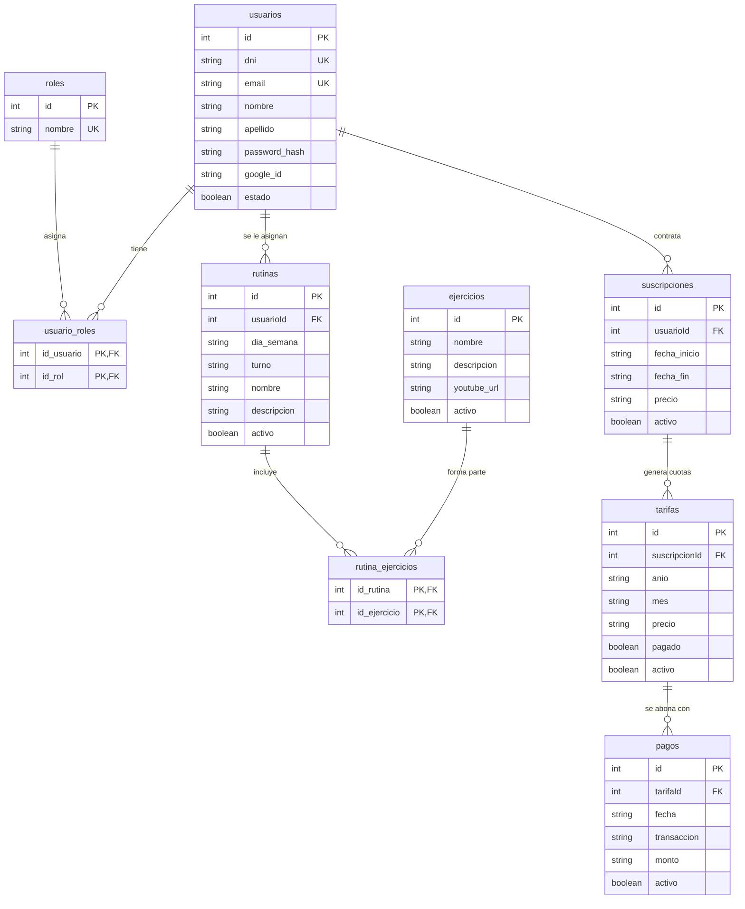

# Proyecto Demo HIA (GymHub)

Proyecto unificado para el trabajo final: **frontend + backend + base de datos relacional** en un solo repositorio.

| Carpeta | Qué es | Tecnología |
|---|---|---|
| [`frontend/`](frontend) | Aplicación web (SPA) | Angular 21, Bootstrap, Chart.js |
| [`backend/`](backend) | API REST | Node.js, Express 5, Sequelize, JWT, Swagger |
| [`database/`](database) | Esquema y datos iniciales | PostgreSQL 16 (vía Docker) |

> Cada subcarpeta conserva su propio README con el detalle de módulos y decisiones de diseño.

## Requisitos

- [Node.js](https://nodejs.org) 20 o superior
- [Docker Desktop](https://www.docker.com/products/docker-desktop/) (para la base de datos)

## Puesta en marcha

### 1. Base de datos

```bash
cp .env.example .env                 # obligatorio: las credenciales de la BD salen solo de acá
docker compose --profile dev up -d   # desarrollo: publica la BD en localhost:5433
```

Crea un PostgreSQL en `localhost:5433` y carga automáticamente [`database/01_schema.sql`](database/01_schema.sql) (tablas) y [`database/02_seed.sql`](database/02_seed.sql) (roles y datos demo).

`DB_NAME`, `DB_USER` y `DB_PASS` son **obligatorias** en `.env` (no versionado): si falta alguna, `docker compose` falla con un mensaje y no arranca.

Perfiles disponibles en [`docker-compose.yml`](docker-compose.yml):

| Perfil | Comando | Servicio | Puerto en el host |
|---|---|---|---|
| `dev` | `docker compose --profile dev up -d` | `db-dev` | `localhost:${DB_PORT:-5433}` |
| `deploy` | `docker compose --profile deploy up -d` | `db` | Ninguno: solo se accede por la red interna `gymhub_db_net` (host `db`) |
| `tools` | se agrega al perfil elegido, p. ej. `docker compose --profile dev --profile tools up -d` | `adminer` | `localhost:8080` |

- No levantes `dev` y `deploy` a la vez: comparten el volumen `db_data`.
- Estado y healthcheck: `docker compose --profile dev ps` tiene que mostrar `healthy`.
- Reiniciar desde cero (borra los datos): `docker compose --profile dev down -v && docker compose --profile dev up -d`
- Visor web opcional (Adminer en http://localhost:8080): `docker compose --profile dev --profile tools up -d`. Espera a que la BD esté `healthy`.
  (sistema: PostgreSQL · servidor: `db` · usuario/clave/base: los de tu `.env`)

### 2. Backend

```bash
cd backend
cp .env.example .env      # y completar JWT_SECRET (las claves externas son opcionales, ver abajo)
npm install
npm run dev               # http://localhost:3000  ·  Swagger: http://localhost:3000/api/docs
```

Las variables `DB_*` del `.env.example` ya apuntan a la base del paso 1. Sin las claves de MercadoPago, YouTube, Google, email o Groq, la API arranca igual pero esas funciones puntuales no van a andar.

### 3. Frontend

```bash
cd frontend
npm install
npm start                 # http://localhost:4200
```

El front consume la API en `http://localhost:3000/api/`.

## Usuarios de prueba

Cargados por `database/02_seed.sql` (**solo desarrollo**). Contraseña de los tres: `demo1234`

| Rol | Email |
|---|---|
| admin | admin@demo.com |
| entrenador | entrenador@demo.com |
| socio | socio@demo.com |

## Modelo de datos



Todas las tablas (salvo `roles`, `usuario_roles` y `rutina_ejercicios`) tienen además `createdAt` y `updatedAt`.

El backend mantiene `sequelize.sync()` al arrancar: si una tabla no existe la crea, pero **no modifica** las existentes. Si se cambia un modelo de Sequelize, hay que reflejar el cambio en `database/01_schema.sql` y recrear la base (`docker compose --profile dev down -v`).

## Notas para el equipo

- **Nunca subir `.env`** (está en `.gitignore`); solo se versiona `.env.example`.
- Flujo de trabajo (ramas, commits, Pull Requests y Definition of Done): ver [`CONTRIBUTING.md`](CONTRIBUTING.md). Resumen: rama `feature/SCRUM-XX-...` desde `develop`, PR hacia `develop` con revisión de al menos otra persona, y `develop → main` al cierre de cada sprint.
- Las URLs de la API están escritas a mano en `frontend/src/app/services/*.ts` (`http://localhost:3000/...`); si se despliega, conviene centralizarlas en un `environment`.
