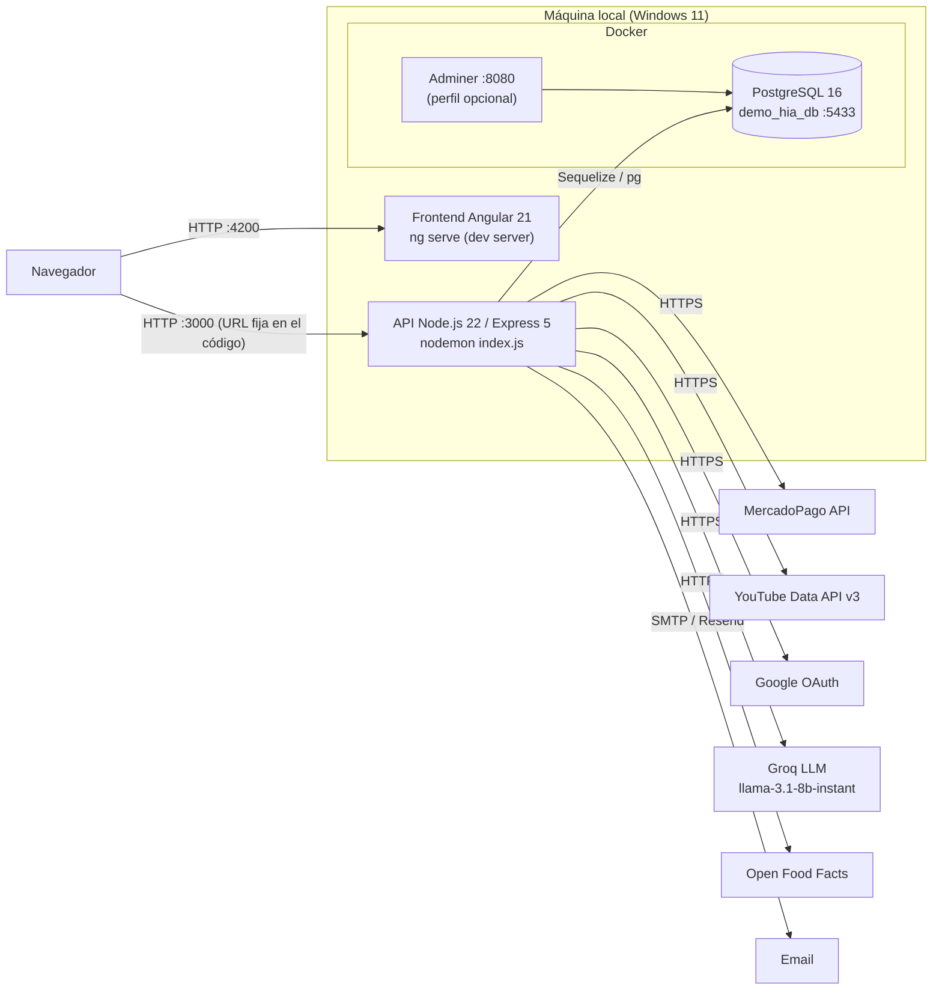
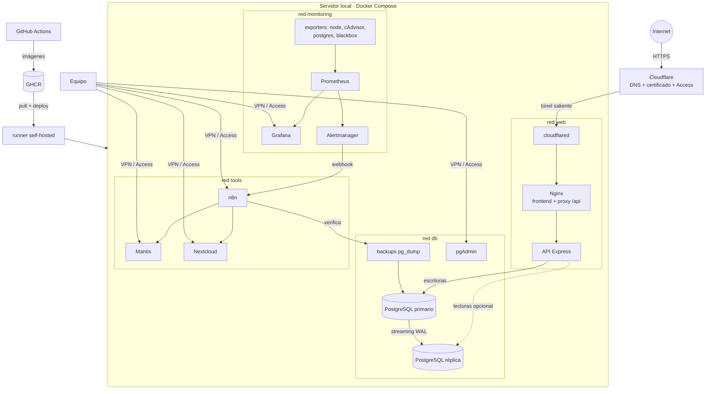

# Arquitectura de GymHub

Ticket: SCRUM-22 · Épica: E01 Selección y diagnóstico

## 1. Arquitectura inicial (estado al 7/11/2026)

Así funciona la aplicación tal como la recibimos: cada componente se ejecuta por separado en la máquina del desarrollador y solo la base de datos está en Docker.

### Componentes

| Componente | Tecnología | Puerto | Cómo se ejecuta | Contenerizado |
|---|---|---|---|---|
| Frontend | Angular 21, Bootstrap 5, Chart.js | 4200 | `npm start` (`ng serve`) | No |
| API REST | Node.js 22, Express 5, Sequelize 6, JWT, bcrypt, Swagger | 3000 | `npm run dev` (nodemon) | No |
| Base de datos | PostgreSQL 16 (alpine) | 5433 → 5432 | `docker compose up -d db` | Sí |
| Cliente de BD | Adminer 4 | 8080 | `docker compose --profile tools up -d` | Sí |

### Flujo de una petición

1. El navegador carga la SPA desde `ng serve` (puerto 4200).
2. Los servicios de Angular llaman directamente a `http://localhost:3000/api/...` (URL escrita en 12 archivos).
3. La API valida el JWT (`auth.middleware.js`) y el rol consultando la base (`rol.middleware.js`).
4. Sequelize ejecuta la consulta en PostgreSQL; al arrancar, `sequelize.sync()` crea las tablas que falten.
5. Algunas funciones llaman a servicios externos: pagos (MercadoPago), videos (YouTube), login (Google), rutinas con IA (Groq), nutrición (Open Food Facts) y emails.

### Limitaciones de esta arquitectura

- Solo funciona en `localhost`: el frontend tiene la URL de la API fija y CORS solo admite `localhost:4200`.
- Frontend y API no están contenerizados: el entorno no es reproducible.
- Un único nodo de base de datos, sin backups ni réplica.
- Sin monitoreo, sin CI/CD y sin acceso desde Internet.

## 2. Componentes a contenerizar

| Servicio | Imagen base | Red | Expuesto al host | Expuesto a Internet |
|---|---|---|---|---|
| `frontend` (Nginx + build de Angular) | `nginx-unprivileged:alpine` | `web` | Sí (80) | Sí, vía túnel |
| `backend` (API) | `node:22-alpine` | `web`, `db` | No | Solo `/api` a través de Nginx |
| `db-primary` | `postgres:16-alpine` | `db` | Solo en dev | No |
| `db-replica` | `postgres:16-alpine` | `db` | No | No |
| `backup` | `postgres:16-alpine` + cron | `db` | No | No |
| `pgadmin` | `dpage/pgadmin4` | `db` | `127.0.0.1` | No |
| `prometheus`, `grafana`, `alertmanager` | oficiales | `monitoring` | `127.0.0.1` | No |
| `node-exporter`, `cadvisor`, `postgres-exporter`, `blackbox-exporter` | oficiales | `monitoring` | No | No |
| `mantis` + `mariadb` | oficiales | `tools` | `127.0.0.1` | No |
| `nextcloud` + `postgres` | oficiales | `tools` | `127.0.0.1` | No (acceso por VPN) |
| `n8n` | `n8nio/n8n` | `tools`, `monitoring` | `127.0.0.1` | Solo webhooks autenticados |
| `cloudflared` | `cloudflare/cloudflared` | `web` | No | Conexión saliente |

## 3. Arquitectura objetivo (al cierre del proyecto)

Principios de la arquitectura objetivo:

- **Una sola puerta de entrada pública:** solo Nginx se publica, a través del túnel; la base y los paneles de administración nunca.
- **Redes separadas:** el frontend no ve la base; las herramientas de operación están en su propia red.
- **Configuración por variables de entorno:** nada de URLs ni credenciales en el código.
- **Todo reproducible con `docker compose`:** perfiles `dev` y `prod`.
