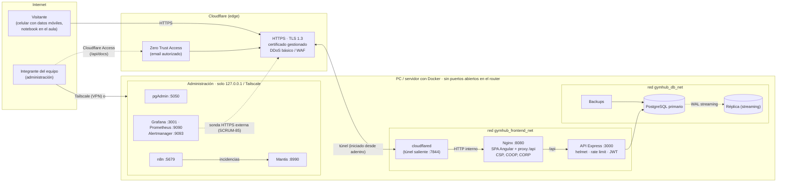

# Documento obligatorio n.º 10 · Publicación en Internet

**Épica:** E09 · Publicación y acceso desde Internet (túnel seguro)  
**Elaborado en:** SCRUM-62 · Valentín Iriarte  
**Tickets relacionados:** SCRUM-60 (túnel y HTTPS), SCRUM-61 (control de acceso y firewall), SCRUM-85 (disponibilidad, errores y riesgos)

## 1. Decisión

GymHub se publica con **Cloudflare Tunnel**. Se descartaron el reenvío de puertos en el router (expone la IP de la casa, requiere IP fija o DDNS y abre un puerto entrante) y un VPS (costo y migración de la BD).

El túnel:

- usa una **conexión saliente**, así que no se abre ningún puerto;
- da **HTTPS con certificado válido** sin administrar certificados;
- oculta la IP de origen y agrega la protección DDoS básica de Cloudflare.

## 2. Diagrama de red



Versión en texto:

```
Internet ──HTTPS──► Cloudflare (TLS, DDoS) ◄══ túnel saliente ══ cloudflared ──► Nginx :8080 ──/api──► API :3000 ──► PostgreSQL ⇢ réplica
                                                                  (red frontend)                       (red db, sin puertos publicados)
Administración: pgAdmin · Grafana/Prometheus/Alertmanager · n8n · Mantis → solo 127.0.0.1 de la PC o por Tailscale
```

| Flujo | Origen → destino | Puerto / protocolo | Abierto en el router |
|---|---|---|---|
| Visitante → app | Internet → Cloudflare | 443/TCP HTTPS | No (lo atiende Cloudflare) |
| Túnel | cloudflared → Cloudflare | 7844 TCP/UDP **saliente** (QUIC/HTTP2) | No |
| Proxy | cloudflared → Nginx | 8080 HTTP, red Docker interna | No |
| API | Nginx → backend | 3000 HTTP, red Docker interna | No |
| Datos | backend → PostgreSQL | 5432, red `gymhub_db_net` | No |
| Administración | Integrante → herramientas | `127.0.0.1` o Tailscale (WireGuard) | No |

## 3. Cómo publicar

| Para qué | Comando |
|---|---|
| Demo / prueba externa (sin cuenta de Cloudflare) | `bash infra/cloudflared/demo-publica.sh` → muestra la URL `https://…trycloudflare.com`. Para cortar: `bash infra/cloudflared/demo-publica.sh --detener` |
| Publicación estable con dominio propio | Token del túnel en `.env` (`CLOUDFLARE_TUNNEL_TOKEN`) y `docker compose -f compose.yaml -f compose.dev.yaml -f compose.tunnel.yaml --profile tunel up -d --build` (detalle en SCRUM-60) |
| Medir disponibilidad | `bash infra/monitoring/publicar-target.sh` + `reporte-disponibilidad.sh` (SCRUM-85) |

## 4. Seguridad de la publicación (resumen)

| Capa | Control | Ticket |
|---|---|---|
| Borde | HTTPS obligatorio, TLS 1.3, DDoS básico, IP de origen oculta | SCRUM-60 |
| Red | Solo Nginx en el túnel; todo lo demás en `127.0.0.1`; nmap desde la LAN sin puertos de GymHub; reglas de firewall | SCRUM-61 |
| Aplicación | CSP, COOP/CORP y `Permissions-Policy` en Nginx; helmet, rate limit, CORS y límite de body en la API | SCRUM-65, SCRUM-81 |
| Detección | Sonda externa + alertas; eventos de seguridad → n8n → Mantis | SCRUM-85, SCRUM-84 |

## 5. Prueba de acceso externo

### 5.1 Prueba realizada desde la PC (13/11/2026)

Desde la PC de desarrollo, por la URL pública del túnel (SCRUM-60):

| Verificación | Resultado |
|---|---|
| `GET /` por HTTPS | 200, TLS verificado, IP remota de Cloudflare (104.16.x.x) |
| Certificado | `*.trycloudflare.com`, Google Trust Services, TLS 1.3 |
| `GET /api/health` | `{"status":"ok","db":"up"}` |
| Login de socio por la API pública | `"Login exitoso."` + JWT |
| Home de la SPA en Chrome | Captura: `evidencias/SCRUM-60/home-por-tunel-https.jpg` |
| IP real del visitante en el backend | Sí: Nginx registra la IP pública en `X-Forwarded-For` |
| Túnel apagado | La URL responde `530` |

> Esta prueba pasa por Internet (DNS público → Cloudflare → túnel), pero **sale desde la misma red** donde está el servidor. El criterio del ticket pide además una prueba desde una red **ajena** (datos móviles). Esa parte es la 5.2.

### 5.2 Protocolo de la prueba con datos móviles (a completar)

1. En la PC: `bash infra/cloudflared/demo-publica.sh` y anotar la URL y la hora que muestra.
2. En el celular: **apagar el Wi-Fi**, usar datos móviles y abrir la URL.
3. Verificar el **candado** (HTTPS válido). Captura 1: home + barra de direcciones + hora del celular.
4. Iniciar sesión como **socio** (usuario demo del README). Captura 2: "¡Hola, Socio!".
5. **Mis Rutinas**: abrir la rutina y reproducir un video. Captura 3.
6. **Mis Pagos**: ver las cuotas. Captura 4.
7. Cerrar sesión. En la PC: `bash infra/cloudflared/demo-publica.sh --detener` y comprobar desde el celular que la URL ya no responde. Captura 5.
8. Guardar las capturas en `docs/evidencias/SCRUM-62/` y completar esta tabla:

| # | Paso | Hora (celular) | Resultado | Captura |
|---|---|---|---|---|
| 1 | Home por HTTPS desde datos móviles | | | |
| 2 | Login de socio | | | |
| 3 | Mis Rutinas + video | | | |
| 4 | Mis Pagos | | | |
| 5 | Túnel apagado → URL no responde | | | |

Datos de contexto para el informe:

- Operador móvil.
- IP pública del celular (por ejemplo, la que muestra `https://ifconfig.me` en el navegador del celular).
- Cantidad de requests registrados en `docker logs gymhub_frontend_dev` con esa IP en `X-Forwarded-For`. Esto demuestra que el acceso vino de afuera.

## 6. Riesgos y plan B

Ver SCRUM-85: la PC tiene que estar encendida, depende de un tercero (Cloudflare) y del ancho de banda doméstico. El plan B para la demo es:

1. Un túnel rápido nuevo.
2. Si no, la demo local en `localhost:8080`.
3. Si no, otra notebook con el repo.
4. Como último recurso, el video de respaldo.

## 7. Criterios de aceptación (SCRUM-62)

| Criterio | Estado |
|---|---|
| Acceso desde un dispositivo fuera de la LAN (datos móviles) con captura y hora | ⏳ **Pendiente:** protocolo y script listos (5.2); falta hacerlo con el celular |
| Login y operación completa de un socio desde el exterior | ⏳ Probado por la URL pública desde la PC (5.1); falta repetirlo desde datos móviles (5.2) |
| Diagrama de red: Internet → Cloudflare → túnel → Nginx → backend → BD, más red de administración | ✔ Sección 2 |
| Documento obligatorio n.º 10 (Publicación en Internet) | ✔ Este documento (se completa con las capturas de 5.2) |
