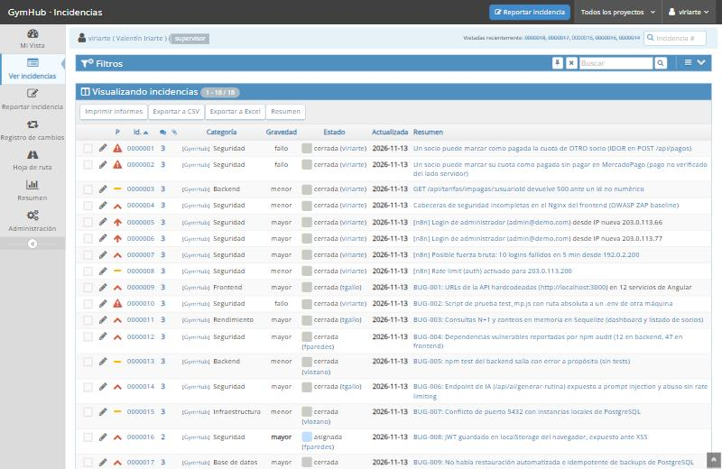
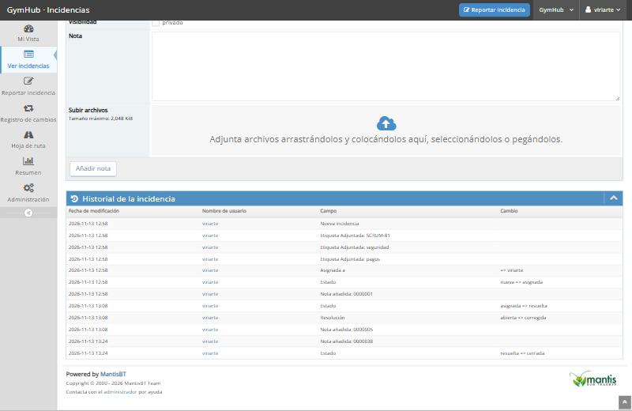

# Documento obligatorio n.º 12 · Gestión de incidencias

**Épica:** E11 · Gestión de incidencias con Mantis  
**Elaborado en:** SCRUM-72 · Valentín Iriarte  
**Rama:** `docs/SCRUM-72-cierre-incidencias`  
**Fecha:** 13/11/2026

## 1. Herramienta y proceso

| Elemento | Detalle |
|---|---|
| Herramienta | Mantis Bug Tracker 2.28.4 en Docker (SCRUM-70), proyecto **GymHub**, solo en `127.0.0.1:8990` |
| Altas | Manuales (integrantes), automáticas desde n8n (`n8n-bot`, flujos 2 y 4) y desde las pruebas de seguridad |
| Flujo de estados | **nueva → asignada → resuelta → cerrada** |
| Resuelta | El fix está mergeado en `develop`. La nota de resolución referencia el **PR** y el merge commit |
| Cerrada | Alguien **verificó** la corrección en el entorno actual. La nota de cierre incluye la verificación y la **evidencia** (comando, log, test o captura) |
| Trazabilidad | Ticket de Jira en la información adicional y como etiqueta (`SCRUM-XX`); PR de GitHub en la nota de resolución; evidencia en `docs/evidencias/` |
| Operación por API | [`infra/mantis/incidencias.js`](../infra/mantis/incidencias.js) (`crear`, `asignar`, `resolver`, `cerrar`, `nota`, `ver`, `listar`) con token personal en `MANTIS_TOKEN` |

## 2. Estado de las incidencias



| Mantis | Origen | Incidencia | Categoría · Severidad | Responsable | PR | Estado |
|---|---|---|---|---|---|---|
| #9 | BUG-001 · SCRUM-50 | URLs de la API hardcodeadas en 12 servicios de Angular | Frontend · mayor | tgallo | [#1](https://github.com/valentiniriar/proyecto_demo_hia/pull/1) | ✅ cerrada |
| #10 | BUG-002 · SCRUM-31 | `test_mp.js` con ruta absoluta a un `.env` de otra máquina | Seguridad · fallo | viriarte | [#32](https://github.com/valentiniriar/proyecto_demo_hia/pull/32) | ✅ cerrada |
| #11 | BUG-003 · SCRUM-42 | Consultas N+1 y conteos en memoria en Sequelize | Rendimiento · mayor | tgallo | [#9](https://github.com/valentiniriar/proyecto_demo_hia/pull/9) | ✅ cerrada |
| #12 | BUG-004 · SCRUM-64 | Dependencias vulnerables (12 backend / 47 frontend) | Seguridad · mayor | fparedes | [#4](https://github.com/valentiniriar/proyecto_demo_hia/pull/4) | ✅ cerrada |
| #13 | BUG-005 · SCRUM-32 | `npm test` salía con error a propósito | Backend · menor | vlozano | [#14](https://github.com/valentiniriar/proyecto_demo_hia/pull/14) | ✅ cerrada |
| #14 | BUG-006 · SCRUM-82 | Prompt injection y abuso en `/api/ai/generar-rutina` | Seguridad · mayor | tgallo | [#10](https://github.com/valentiniriar/proyecto_demo_hia/pull/10) | ✅ cerrada |
| #15 | BUG-007 · SCRUM-24 | Conflicto del puerto 5432 con PostgreSQL local | Infraestructura · menor | vlozano | [#13](https://github.com/valentiniriar/proyecto_demo_hia/pull/13) | ✅ cerrada |
| #16 | BUG-008 · SCRUM-83 | JWT en `localStorage` expuesto ante XSS | Seguridad · mayor | fparedes | — | ⏳ **asignada**: SCRUM-83 está "Por hacer" |
| #17 | BUG-009 · SCRUM-38 | Sin restauración automatizada de backups | Base de datos · mayor | vlozano | [#17](https://github.com/valentiniriar/proyecto_demo_hia/pull/17) | ✅ cerrada |
| #18 | BUG-010 · SCRUM-45 | Réplica sin replication slot | Infraestructura · mayor | vlozano | [#19](https://github.com/valentiniriar/proyecto_demo_hia/pull/19) | ✅ cerrada |
| #1 | SCRUM-81 | IDOR: un socio marcaba como pagada la cuota de otro socio | Seguridad · fallo | viriarte | [#40](https://github.com/valentiniriar/proyecto_demo_hia/pull/40) | ✅ cerrada |
| #2 | SCRUM-81 | Pago no verificado contra MercadoPago | Seguridad · fallo | viriarte | [#40](https://github.com/valentiniriar/proyecto_demo_hia/pull/40) | ✅ cerrada |
| #3 | SCRUM-81 | 500 ante un id no numérico en `/tarifas/impagas` | Backend · menor | viriarte | [#40](https://github.com/valentiniriar/proyecto_demo_hia/pull/40) | ✅ cerrada |
| #4 | SCRUM-81 | Cabeceras de seguridad incompletas en Nginx | Seguridad · menor | viriarte | [#40](https://github.com/valentiniriar/proyecto_demo_hia/pull/40) | ✅ cerrada |
| #5–#8 | SCRUM-84 | Eventos generados por la **prueba controlada** del flujo n8n 4 | Seguridad | viriarte | [#41](https://github.com/valentiniriar/proyecto_demo_hia/pull/41) | ✅ cerrada (resolución "no requiere cambios") |

**Totales:** 18 incidencias, 17 cerradas y 1 abierta, con su causa y ticket.

- Por categoría: Seguridad 11 · Infraestructura 2 · Backend 2 · Frontend 1 · Rendimiento 1 · Base de datos 1.
- Hay al menos una de **rendimiento** (#11) y varias de **seguridad**, como pide la cátedra.

## 3. Verificación de cada corrección

Salidas completas en [`evidencias/SCRUM-72/verificaciones.txt`](evidencias/SCRUM-72/verificaciones.txt). Cada nota de cierre en Mantis resume su verificación.

| Mantis | Verificación (13/11/2026, entorno `compose.yaml + compose.dev.yaml`) |
|---|---|
| #9 | `grep 'localhost:3000' frontend/src/app` → 0; 12 servicios usan `environment.apiUrl`. La app funciona detrás de Nginx y del túnel |
| #10 | `backend/test_mp.js` no existe; `scripts/test-mp.js` sin rutas absolutas; gitleaks sobre todo el historial sin hallazgos (no había tokens reales) |
| #11 | `/api/dashboard/stats` = admins 1 · entrenadores 1 · socios 7, igual al `COUNT … GROUP BY` directo en PostgreSQL (0,25 s); `/socios/list` devuelve los 7 socios con un JOIN (0,23 s). **Las cifras con 6M filas del registro original (48 s → 42 ms) no se reprodujeron:** el dataset grande no está cargado en este entorno |
| #12 | `npm audit --omit=dev --audit-level=high` → exit 0 en backend y frontend |
| #13 | `npm test` → 37/37 en 5 suites; corre en cada PR |
| #14 | `ai-security.test.js` 5/5 (rechaza instrucciones maliciosas, 10 req/15 min por usuario, no expone la API key) |
| #15 | BD de GymHub en `127.0.0.1:5433` funcionando junto al PostgreSQL 17 nativo en 5432 |
| #17 | `pg_dump -Fc` (23,7 KB) → `pg_restore` en una base nueva → conteos idénticos usuarios/tarifas/pagos/rutina_ejercicios = **9/8/5/3** |
| #18 | `pg_stat_replication`: `streaming`, lag 2 ms; slot `standby_slot_1` activo; una fila insertada en el primario aparece en la réplica; la réplica rechaza escrituras |
| #1–#4 | Script de pruebas de SCRUM-81 después del fix: 23/23 OK; ZAP 11 → 9 WARN, 0 FAIL; 11 tests de regresión de pagos en el CI |
| #5–#8 | El flujo 4 detectó y clasificó cada evento como se esperaba (SCRUM-84, sección 5.3) |

## 4. Historial de estados

Cada incidencia muestra en Mantis la secuencia completa. Ejemplo (#1):



```
2026-11-13 12:58 viriarte: Nueva incidencia
2026-11-13 12:58 viriarte: Asignada a → viriarte
2026-11-13 12:58 viriarte: Estado nueva → asignada
2026-11-13 13:08 viriarte: Estado asignada → resuelta
2026-11-13 13:08 viriarte: Resolución abierta → corregida        (nota: PR #40, merge 84ffae8)
2026-11-13 13:24 viriarte: Estado resuelta → cerrada            (nota: verificación + evidencia)
```

Historial completo de las 18 incidencias: [`evidencias/SCRUM-72/historial-mantis.txt`](evidencias/SCRUM-72/historial-mantis.txt).

## 5. Observaciones

- Las incidencias BUG-001…BUG-010 se habían relevado en SCRUM-71 antes de que existiera la instancia de Mantis (SCRUM-70). En este ticket se **cargaron en Mantis** respetando reportero, responsable, categoría y severidad del relevamiento, y se recorrió su ciclo de vida con los PR **reales**. La única diferencia con el relevamiento: BUG-002 se resolvió en el PR **#32**, no en el #2.
- Las transiciones las registró el coordinador de incidencias (`viriarte`). Para el próximo sprint, cada responsable resuelve las suyas con su propio usuario (las credenciales iniciales están en `infra/mantis/credenciales.local.json`, que no se versiona).
- **#16 (BUG-008)** queda abierta a propósito: no hay corrección mergeada. Se cierra cuando se complete SCRUM-83.

## 6. Criterios de aceptación (SCRUM-72)

| Criterio | Estado |
|---|---|
| Cada incidencia con solución aplicada, commit/PR referenciado y verificación de la corrección | ✔ Secciones 2 y 3 (17 de 18; #16 sin solución todavía, documentado) |
| Cierre con evidencia (captura, log o test) | ✔ Nota de cierre en cada incidencia + `docs/evidencias/SCRUM-72/` |
| Historial de estados visible (asignada → resuelta → cerrada) | ✔ Sección 4 + export completo |
| Documento obligatorio n.º 12 (Gestión de incidencias) | ✔ Este documento |
