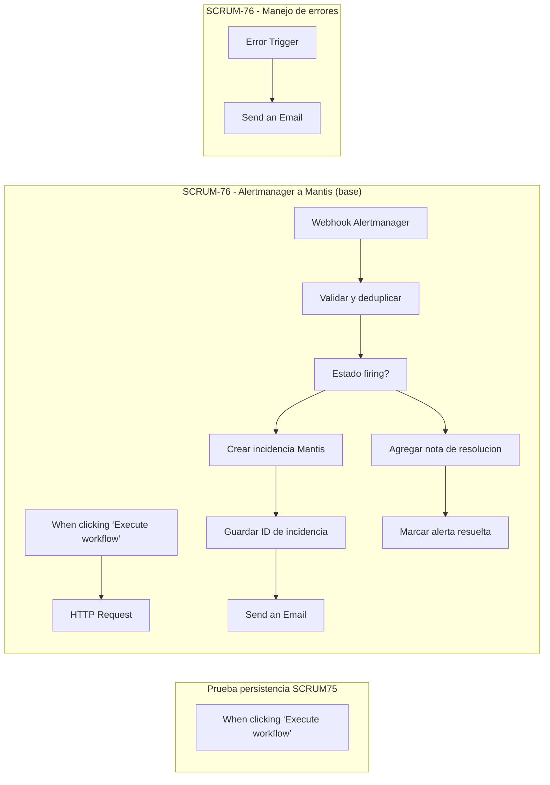

# Documento técnico n.º 13 — Seguridad y pruebas de automatizaciones (SCRUM-79)

**Generado:** 2026-11-14 14:02:30 -0300
**Ambiente:** GymHub, n8n local aislado en Docker.
**Estado:** Evidencia automática parcial. No afirmar tarea terminada hasta resolver los pendientes.

## 1. Objetivo y alcance

Verificar webhooks autenticados, manejo global de errores, control humano para acciones críticas, pruebas de fallos y exportaciones versionadas. Este documento automatiza la inspección y las pruebas negativas seguras; NO activa/deactiva flujos, reinicia servicios, toca Mantis ni expone secretos.

## 2. Inventario y diagramas de workflows

**Exportación local:** OK (transitoria; archivo crudo eliminado después del análisis).

| Workflow | Nodos | Disparadores | Acciones / condiciones | Error Workflow asociado | Wait |
|---|---:|---|---|---|---|
| Prueba persistencia SCRUM75 | 1 | When clicking ‘Execute workflow’ | No identificada | no | no |
| SCRUM-76 - Alertmanager a Mantis (base) | 10 | When clicking ‘Execute workflow’, Webhook Alertmanager | HTTP Request, Validar y deduplicar, Estado firing?, Crear incidencia Mantis, Guardar ID de incidencia, Agregar nota de resolucion, Marcar alerta resuelta, Send an Email | sí | no |
| SCRUM-76 - Manejo de errores | 2 | Error Trigger | Send an Email | no | no |

## 3. Seguridad y autenticación

- El stack Docker configura UI n8n en loopback (`127.0.0.1:5679`) y `N8N_ENCRYPTION_KEY` por `.env` no versionado (SCRUM-75).
- Se inspeccionan las opciones de autenticación de los nodos Webhook y se evita publicar identificadores o contenidos de credenciales.
- El flujo SCRUM-76 tiene manejo de errores separado por `Error Trigger` y correo SMTP Mailpit, probado previamente en el laboratorio.
- **Limitación:** cobertura global exige que *cada workflow apropiado* tenga Error Workflow asignado; no se infiere por un solo flujo.
- **Limitación:** la verificación de 2FA del usuario owner requiere revisión puntual en UI, no se extraen secretos ni códigos.

## 4. Pruebas ejecutadas automáticamente

| Verificación | Resultado |
|---|---|
| Editor n8n local | `200` |
| Mailpit local | `200` |
| Mantis local | `200` |
| Acceso anónimo rechazado por webhook | `403` |
| Payload inválido autorizado procesado | `200` |
| Correo nuevo de error recibido | `True` |

`HTTP 200` del webhook no prueba que el procesamiento interno haya tenido éxito: n8n responde inmediatamente. Se registra el nuevo correo de error para comprobar el flujo de fallos.

**Prueba segura:** se envía un payload inválido (`alerts` no es arreglo), que falla en el nodo de validación **antes** de crear un ticket en Mantis. No se prueban cierres/reinicios ni cambios de datos del resto de workflows.

## 5. Exportaciones JSON presentes en GitHub/repo

- `infra/n8n/workflows/SCRUM-76-alertmanager-mantis.json` — SCRUM-76 - Alertmanager a Mantis (base)
- `infra/n8n/workflows/SCRUM-76-manejo-errores.json` — SCRUM-76 - Manejo de errores
- `infra/n8n/workflows/flujo-2-verificacion-backups.json` — Flujo 2 - Verificación de Backups y Notificación de Errores
- `infra/n8n/workflows/flujo-4-eventos-seguridad.json` — Flujo 4 - Eventos de seguridad → clasificación → incidencia en Mantis

El script **no publica exportaciones crudas** de n8n (pueden incluir URLs, IDs o información sensible de parámetros). La exportación temporal se borra tras análisis. Las exportaciones al repo deben ser revisadas y sanitizadas antes de `git add`.

## 6. Riesgos y mitigaciones

| Riesgo | Impacto | Mitigación / estado |
|---|---|---|
| Token del webhook expuesto | Inyección de alertas falsas | Header Auth, secret fuera del repo; no mostrar tokens en logs |
| Workflow falla y no avisa | Incidencia sin seguimiento | Error Trigger + SMTP Mailpit; extender a los demás workflows |
| Acciones críticas sin aprobación | Cortes de servicio o pérdida de datos | Wait/aprobación humana obligatoria si existe una acción crítica; pendiente de validar por flujo |
| Duplicados por concurrencia | Varios tickets para una alerta | Deduplicación por fingerprint probada en secuencia; evaluar persistencia transaccional para producción |
| Credenciales incrustadas en nodos | Filtración en repo o capturas | Uso de n8n Credentials y revisión previa de exportaciones |
| Alertas sin recepción real | Monitoreo incompleto | Probar regla Prometheus → Alertmanager en SCRUM-68 (separado de esta auditoría) |
| Pruebas destructivas | Interrupción de los demás TPs | No automatizar reinicios/failover; pruebas aisladas o aprobadas con el equipo |

## 7. Criterios de aceptación y estado

- [x] Evidencia de autenticación y control de payload para SCRUM-76 disponible.
- [x] Se detectó Error Trigger en los workflows locales inspeccionados.
- [x] Nueva notificación de error recibida en esta auditoría.
- [ ] Error workflow **global** comprobado en los demás flujos.
- [ ] Aprobación humana antes de acciones críticas: revisar cada flujo y definir acción de ejemplo si corresponde.
- [ ] Falla intencional documentada de cada flujo (SCRUM-77 y SCRUM-78, si están operativos).
- [x] Documentación técnica y diagrama generados automáticamente para los flujos disponibles.
- [ ] Revisión de todas las exportaciones JSON sin credenciales del conjunto de flujos del proyecto.

## 8. Pendientes de cierre

- No se observó nodo Wait/aprobación humana; validar acciones críticas antes de implementar
- Pruebas de fallo controladas de cada flujo que no sea SCRUM-76 (backups/IA) no ejecutadas: evitar operaciones destructivas
- Aprobación humana en acciones críticas: la existencia de Wait no demuestra política completa
- Validar con responsable/riesgos y documentación del resto del equipo

**Archivo de evidencia estructurada:** `docs/evidencias/SCRUM-79/auditoria-local.json`. Contiene resultados y nombres de nodos, no contraseñas ni tokens.

**Nota:** este reporte muestra lo verificado en la instalación local en la fecha indicada y no reemplaza las pruebas del sistema de todo el equipo.

## 9. Revisión integral de flujos y aprobaciones (SCRUM-79)

### Inventario local y alcance real

El export temporal de la instancia local n8n detectó **exactamente tres workflows**:

1. `Prueba persistencia SCRUM75` — manual/inactivo, utilizado para comprobar persistencia, no es uno de los tres flujos funcionales de la épica.
2. `SCRUM-76 - Alertmanager a Mantis (base)` — activo, con Webhook autenticado y Error Workflow asociado; se verificó respuesta 403 sin autorización y correo nuevo tras payload inválido autorizado.
3. `SCRUM-76 - Manejo de errores` — activo, recibe errores del workflow principal y envía notificación en Mailpit.

El flujo de **backups SCRUM-77** está versionado en `infra/n8n/workflows/flujo-2-verificacion-backups.json` (PR #25), pero **no está instalado en esta instancia**. El flujo **IA → Nextcloud SCRUM-78** tampoco se detectó. Por lo tanto sus ejecuciones fallidas, seguridad en producción y notificaciones **no fueron verificadas** en este entorno. No corresponde declararlas exitosas.

### Política de aprobación humana basada en riesgo

El flujo SCRUM-76 gestionado localmente crea incidencias, agrega notas en Mantis y envía correos. No se detectaron operaciones de reinicio, borrado, failover, modificación de backups o ejecución de comandos de sistema en su JSON versionado. **No se inserta un Wait artificial en la automatización de alertas**, pues detener cada aviso hasta su aprobación perjudicaría el monitoreo. La política para todos los flujos es: **antes de una acción crítica o destructiva**, agregar `Wait`/aprobación expresa de persona responsable y documentar quién aprueba y cómo se retoma la ejecución. Esta política debe comprobarse cuando el flujo correspondiente exista y se ejecute.

### Inspección estática adicional de SCRUM-77 (no ejecutado)

- Existe exportación JSON en `develop` con disparador programado, comando de **lectura** de metadata y creación de incidencia ante backup inválido.
- Nodos `Execute Command` detectados: **1**. La exportación no fue ejecutada; su lectura de metadata no demuestra acceso correcto al volumen.
- El JSON no incluye el `Error Workflow` de SCRUM-76 vinculado en su configuración exportada.
- Observaciones de configuración/seguridad:
- Authorization usa $env en un parámetro de nodo; migrar a Credentials y verificar bloqueo de entorno.
- El stack versionado SCRUM-75 fija `N8N_BLOCK_ENV_ACCESS_IN_NODE=true`; por eso deben revisarse expresiones `$env` y reemplazarlas por el gestor **Credentials** cuando corresponda. La credencial del bot Mantis no debe guardarse en texto dentro de un nodo.
- La exportación existente no significa que el flujo esté habilitado o probado, ni que el SMTP/email esté validado.

### Criterios de aceptación del ticket y decisión

| Criterio | Evidencia | Estado |
|---|---|---|
| Webhook autenticado y sin tokens en claro | SCRUM-76: 403 sin auth, exportación sanitizada | Comprobado para 76 |
| Manejo de errores con registro/aviso | SCRUM-76: Error Trigger + correo Mailpit | Comprobado para 76; cobertura global pendiente |
| Aprobación humana ante acciones críticas | Política documentada; 76 sin acciones destructivas detectadas | Pendiente de comprobar en otros flujos |
| Prueba negativa de **cada** flujo | Payload inválido y correo para 76 | SCRUM-77/78 no probados localmente |
| Documento n.º 13 y diagramas | Documento generado desde 3 workflows locales | Disponible; revisión del equipo pendiente |
| Exportaciones sin credenciales | JSON SCRUM-76 y SCRUM-77 versionados; SCRUM-78 sin evidencia | Parcial |

**Conclusión:** la seguridad y gestión de errores de SCRUM-76 quedaron verificadas; **SCRUM-79 permanece En curso** por dependencias de SCRUM-77 y SCRUM-78 y revisión de la política de aprobación. Este documento y la evidencia se pueden versionar como avance verificable sin afirmar cierre total.
