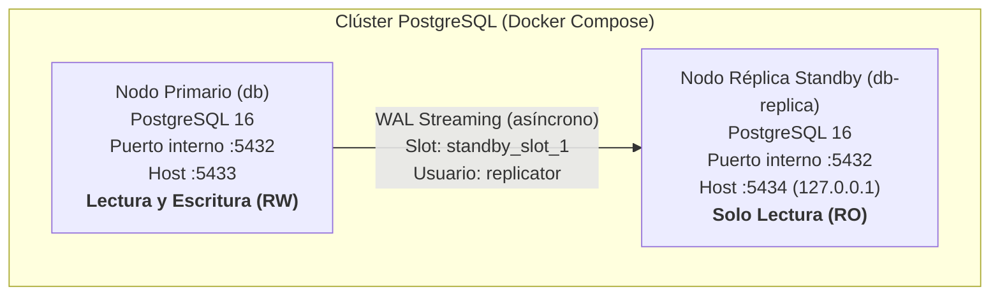

# Configuración de Clúster PostgreSQL 16 con Streaming Replication

- **Ticket:** SCRUM-45
- **Épica:** SCRUM-10 (E06 · Clúster y replicación de PostgreSQL)
- **Responsable:** Valentín Lozano
- **Fecha:** 12/11/2026
- **Estado:** Implementado y versionado

---

## 1. Arquitectura y Roles de Nodos

La arquitectura de alta disponibilidad de base de datos se conforma por dos nodos PostgreSQL 16 ejecutándose en contenedores independientes sobre la red Docker:



### 1.1 Nodo Primario (`db` / `demo_hia_db`)
- **Rol:** Nodo maestro activo de Lectura y Escritura (Read-Write).
- **Responsabilidad:** Recibe todas las transacciones de inserción, actualización y borrado de la API Express. Genera los registros Write-Ahead Log (WAL) y los transmite en tiempo real hacia las réplicas conectadas.
- **Configuración de replicación:**
  - `wal_level = replica`.
  - `max_wal_senders = 10`.
  - `max_replication_slots = 10`.
  - Script de arranque `database/replication/setup-primary.sh`: Crea el usuario con privilegios `REPLICATION` (`replicator`), el replication slot físico `standby_slot_1` y autoriza la red en `pg_hba.conf`.

### 1.2 Nodo Réplica (`db-replica` / `demo_hia_db_replica`)
- **Rol:** Réplica física Hot Standby de Solo Lectura (Read-Only).
- **Responsabilidad:** Mantiene una copia binaria exacta y en tiempo real del catálogo y los datos del primario. Puede absorber tráfico de lectura y reportes pesados. En caso de desastre, está listo para ser promovido a primario.
- **Inicialización:**
  - Script `database/replication/entrypoint-replica.sh`: Al arrancar sin datos, ejecuta `pg_basebackup` contra el nodo primario con los flags `-R` (genera `standby.signal` y configuración automática de conexión) y `--slot=standby_slot_1`.
  - Al iniciar en modo standby, la función interna `pg_is_in_recovery()` retorna `true`, bloqueando cualquier intento de escritura directa.

---

## 2. Puesta en Marcha

Para iniciar el clúster replicado con Docker Compose:
```bash
docker compose --profile cluster up -d
```

### 2.1 Verificación del estado en el Primario:
```bash
docker compose exec db psql -U demo_hia -d demo_hia -c "SELECT client_addr, usename, application_name, state, sync_state FROM pg_stat_replication;"
```
*Salida esperada:*
```text
 client_addr |   usename  | application_name |   state   | sync_state 
-------------+------------+------------------+-----------+------------
 172.x.x.x   | replicator | walreceiver      | streaming | async
```

### 2.2 Verificación en la Réplica (Modo Standby):
```bash
docker compose exec db-replica psql -U replicator -d demo_hia -c "SELECT pg_is_in_recovery();"
```
*Salida esperada:*
```text
 pg_is_in_recovery 
-------------------
 t
```
*(Retorna `t` confirmando que opera como réplica de solo lectura).*
