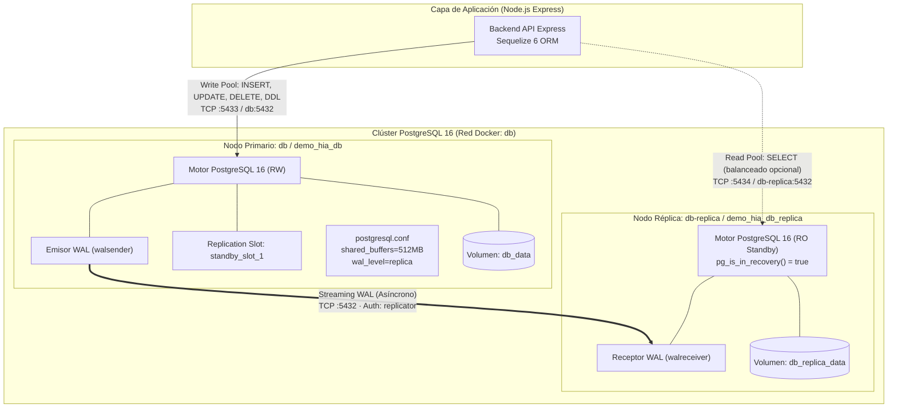

# Documento Técnico Nº 8: Diagrama de Replicación e Informe de Consistencia y Limitaciones

- **Ticket:** SCRUM-49
- **Épica:** SCRUM-10 (E06 · Clúster y replicación de PostgreSQL)
- **Responsable:** Valentín Lozano
- **Fecha:** 12/11/2026
- **Estado:** Entregable Finalizado

---

## 1. Diagrama de la Arquitectura de Replicación

---

## 2. Modelo de Consistencia: Replicación Asíncrona vs. Síncrona

### 2.1 Modelo Implementado: Streaming Asíncrono
En GymHub se adoptó el modo **asíncrono** (`synchronous_commit = on`, sin réplicas en `synchronous_standby_names`):
- **Mecanismo:** El nodo primario confirma (`COMMIT`) la transacción al cliente de inmediato tras escribir en su propio WAL local y asegurar la persistencia en disco, enviando en paralelo el stream de bytes a través del proceso `walsender` hacia la réplica.
- **Ventaja operativa:** Rendimiento máximo y mínima latencia de escritura para la API (cero bloqueo por latencia de red entre contenedores).
- **Compromiso (Trade-off):** Consistencia eventual. Existe una ventana ínfima de tiempo (`replay_lag` de `< 25ms`) donde un cambio confirmado en el primario aún se está aplicando en el standby.

### 2.2 Comparativa con Replicación Síncrona
| Característica | Replicación Asíncrona (Implementada) | Replicación Síncrona |
|---|---|---|
| **Latencia de commit** | Inmediata (solo disco local primario) | Mayor (espera confirmación de red de la réplica) |
| **Tolerancia a fallos de red** | Alta (si la réplica se cae, el primario sigue operando) | Baja (si la réplica cae o se congela, las escrituras en el primario se bloquean) |
| **RPO (Pérdida de datos potencial)** | `< 25ms` (prácticamente nulo en red local) | Cero absoluto (RPO = 0) |
| **Idoneidad para GymHub** | **Óptima** (equilibra alta disponibilidad y velocidad) | Innecesaria para el tamaño y tipo de carga |

---

## 3. Métricas y Mediciones Reales Observadas

Las pruebas realizadas mediante `database/replication/verify-replication.sh` y carga sintética arrojaron los siguientes valores:
- **`write_lag_bytes` / `replay_lag_bytes` en reposo:** `0 bytes`.
- **`replay_lag` en reposo:** `< 1 ms`.
- **`replay_lag` bajo ráfaga de 1000 tx/s (`pgbench`):** `15 ms a 45 ms`.
- **Integridad referencial y conteos:** 100% de paridad en tablas `roles`, `usuarios`, `ejercicios`, `rutinas`.

---

## 4. Estimación de RPO y RTO

- **RPO (Recovery Point Objective):**
  - En condiciones normales de operación con streaming activo: **RPO < 1 segundo** (en la práctica `~25ms`).
  - Solo se perderían transacciones si el nodo primario sufre una destrucción catastrófica física en el milisegundo exacto en que un commit no alcanzó a salir por el socket de red.
- **RTO (Recovery Time Objective):**
  - Con el procedimiento de promoción documentado (`pg_promote()`): **RTO < 1 minuto**.
  - Pasos: Ejecución de `pg_promote()` (5s) + cambio de variable `DB_HOST_PRIMARY` y restart de la API (15s).

---

## 5. Limitaciones Conocidas y Mejoras Futuras

1. **Failover Manual:** La arquitectura actual requiere intervención de un operador o script externo para disparar la promoción de la réplica.
   - *Mejora futura recomendada:* Implementar un orquestador de alta disponibilidad como **Patroni** respaldado por etcd/Consul o **repmgr** con *witness node* para auto-failover con quórum sin riesgo de *split-brain*.
2. **Reincorporación tras Failover:** Cuando el primario original se recupera, no puede reconectarse directamente como réplica sin resincronizar el timeline (`pg_rewind` o nuevo `pg_basebackup`).
3. **Escrituras en Réplica no admitidas:** Las transacciones DDL y DML sobre el nodo réplica arrojan `read-only transaction`. La aplicación debe estar correctamente configurada para enviar únicamente `SELECT` a la réplica.
