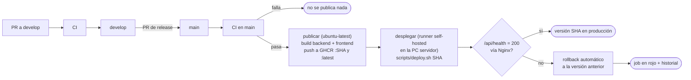

# Despliegue continuo (CD) de GymHub

Tickets: SCRUM-56 (imágenes en GHCR) · SCRUM-57 (despliegue automático) · SCRUM-59 (commit de prueba y rollback)
Épica: E08 Integración y despliegue continuos · Responsable: Francisco Paredes

## 1. Flujo



| Pieza | Archivo | Qué hace |
|---|---|---|
| Workflow | `.github/workflows/cd.yml` | Se dispara cuando termina el CI de `main`. Si el CI falló, no hace nada. |
| Job `publicar` | `cd.yml` | Construye las imágenes del commit que validó el CI y las publica en `ghcr.io/valentiniriar/gymhub-{backend,frontend}` con dos tags: el **SHA del commit** (inmutable) y `latest`. |
| Job `desplegar` | `cd.yml` | Corre en el **runner self-hosted** de la PC servidor (labels `self-hosted, gymhub`), en el environment `produccion`. Ejecuta `scripts/deploy.sh <SHA>`. |
| Script | `scripts/deploy.sh` | Descarga la versión, la levanta, verifica la salud de punta a punta y hace rollback automático si falla. |
| Compose | `compose.prod.yaml` | Las imágenes usan `${IMAGE_TAG}`: desplegar o volver atrás es "levantar el SHA X". |

## 2. Decisiones

- **El CD solo arranca si el CI pasó** (`workflow_run` + `conclusion == success`): un cambio que rompe build, tests, auditoría o gitleaks nunca se publica.
- **Tag = SHA del commit**: cada versión es inmutable y trazable al commit; `latest` es solo una comodidad.
- **Los secretos de producción no están en GitHub**: viven en `C:\gymhub\.env.prod` en el servidor. El pipeline solo usa el `GITHUB_TOKEN` efímero (permisos `packages: write` para publicar, `packages: read` para descargar).
- **Runner self-hosted en vez de SSH**: el servidor abre una conexión saliente hacia GitHub; no hay que exponer SSH ni abrir puertos (igual que el túnel de Cloudflare).
- **El túnel no se toca al desplegar**: `deploy.sh` recrea solo `db`, `db-replica`, `backup`, `backend` y `frontend`. Si se recreara `cloudflared`, el túnel rápido cambiaría de URL.
- **Producción aislada de desarrollo en la misma PC**: proyecto Compose `gymhub`, contenedores `gymhub_*_prod`, redes `gymhub_prod_*` y volúmenes `gymhub_prod_*`. El frontend escucha solo en `127.0.0.1:80`; desde Internet se entra por el túnel.

## 3. Puesta en marcha del servidor (una sola vez)

Requisitos en la PC servidor: Docker Desktop abierto, Git para Windows (aporta `bash`).

### 3.1 Secretos de producción

Crear `C:\gymhub\.env.prod` (fuera del repo) con contraseñas propias:

```ini
DB_NAME=gymhub
DB_USER=gymhub
DB_PASS=<aleatoria>
POSTGRES_REPLICA_USER=replicator
POSTGRES_REPLICA_PASSWORD=<aleatoria>
JWT_SECRET=<aleatoria, 48+ bytes>
BACKUP_CRON_SCHEDULE=0 3 * * *
BACKUP_RETENTION_DAYS=7
RUN_BACKUP_ON_STARTUP=true
CLOUDFLARE_TUNNEL_TOKEN=
```

Generar valores: `node -e "console.log(require('crypto').randomBytes(32).toString('hex'))"`.

### 3.2 Runner self-hosted

Registrar un runner exige ser **dueño del repositorio** (`valentiniriar`):

1. El dueño entra a *Settings → Actions → Runners → New self-hosted runner → Windows x64* y copia el token (vale 1 hora).
2. En la PC servidor, en PowerShell, seguir los comandos de esa página (descargar y descomprimir en `C:\actions-runner`) y configurar con el label `gymhub`:
   ```powershell
   cd C:\actions-runner
   .\config.cmd --url https://github.com/valentiniriar/proyecto_demo_hia --token <TOKEN> --name pc-servidor-gymhub --labels gymhub --work _work --unattended
   .\run.cmd
   ```
3. Dejar `run.cmd` abierto. Se ejecuta con el usuario de Windows, que es el que tiene acceso a Docker Desktop (un servicio con la cuenta *NETWORK SERVICE* no puede usar Docker Desktop).

En *Settings → Actions → Runners* el runner aparece como **Idle**.

### 3.3 Publicar en Internet

```bash
bash scripts/deploy.sh --tunel     # túnel rápido de Cloudflare apuntando al frontend de producción
```

Muestra la URL `https://….trycloudflare.com`. Los despliegues posteriores no la cambian.

## 4. Operación

| Acción | Cómo |
|---|---|
| Desplegar | Mergear un PR de release `develop → main`. El resto es automático. |
| Ver la versión en producción | `bash scripts/deploy.sh --estado` (versión actual y últimos 10 despliegues) |
| Historial | `C:\gymhub\historial-despliegues.log` y *Actions → CD* / *Environments → produccion* en GitHub |
| Rollback manual | *Actions → CD → Run workflow*, `tag` = SHA completo de la versión anterior (`git log main --format=%H`). O en el servidor: `bash scripts/deploy.sh <SHA>` |

### Rollback automático

`deploy.sh` considera exitoso un despliegue solo si:

1. `docker compose up --wait` deja `db`, `db-replica` y `backend` en estado *healthy* (healthchecks de Postgres y `HEALTHCHECK` del backend sobre `/api/health`), y
2. `http://127.0.0.1/api/health` responde **200 a través de Nginx** (frontend → backend → base de datos).

Si algo falla, vuelve a levantar la versión registrada en `C:\gymhub\version-desplegada.txt`, la verifica de la misma forma y termina con error para que el job quede en rojo.

## 5. Evidencia de la prueba local (18/11/2026)

Prueba en la PC servidor con imágenes construidas localmente (`SKIP_PULL=1`), antes de conectar el pipeline:

```
[13:46:46] Versión actual: ninguna · versión a desplegar: prueba1
[13:47:06] ✔ http://127.0.0.1/api/health respondió 200
[13:47:06] ✔ Despliegue de prueba1 completado

# prueba2 = backend que termina al arrancar (falla simulada)
[13:47:23] Versión actual: prueba1 · versión a desplegar: prueba2
container gymhub_backend_prod is unhealthy
[13:47:29] ✖ El despliegue de prueba2 falló
[13:47:30] ↩ Rollback automático a prueba1
[13:47:39] ✔ http://127.0.0.1/api/health respondió 200
[13:47:39] ✔ Servicio restaurado en prueba1          (exit 1)
```

- Detección de la falla: 6 s. Servicio restaurado: 9 s después.
- Con `prueba1`: login de `admin@demo.com` OK, SPA servida por Nginx (200) y réplica en modo solo lectura (`pg_is_in_recovery() = t`).

Pendiente de evidencia en GitHub (SCRUM-59): ejecución del workflow CD tras un commit de prueba en `main` y un rollback manual con *Run workflow*.

## 6. Limitaciones

- El servidor es una PC personal: si está apagada o sin Docker Desktop, el job `desplegar` queda en espera hasta que el runner vuelva.
- El rollback revierte las **imágenes**, no la base de datos. Un cambio de esquema incompatible requiere restaurar un backup (SCRUM-38).
- El túnel rápido de Cloudflare no garantiza disponibilidad ni URL fija; para producción real se usa el túnel con nombre (perfil `tunel`, SCRUM-60).
