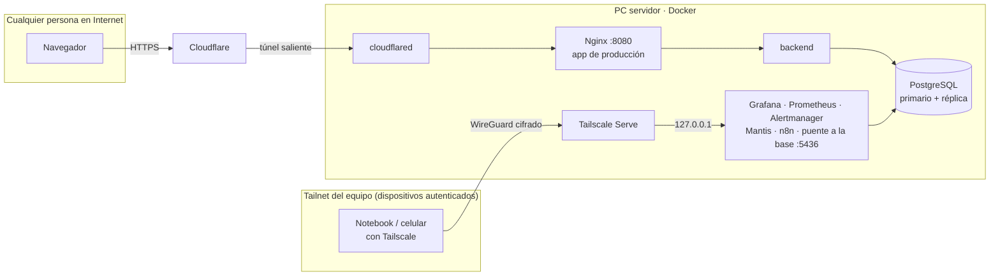

# Acceso público y acceso administrativo al servidor de GymHub

Tickets: SCRUM-61 (control de acceso) · SCRUM-57 (servidor de producción) · SCRUM-66/67/68 (monitoreo)
Épica: E09 Publicación y acceso desde Internet · Responsable: Francisco Paredes

## 1. Dos puertas distintas

El servidor es una PC de escritorio con Docker. Tiene **dos caminos de entrada separados**, con públicos y controles distintos:



| | Puerta pública | Puerta administrativa |
|---|---|---|
| Para quién | Cualquier persona | Solo el equipo |
| Tecnología | Cloudflare Tunnel | Tailscale (WireGuard) |
| Qué expone | Solo Nginx (la app y `/api`) | Paneles de operación y la base de producción |
| Autenticación | La de la app (JWT) | Cuenta de Tailscale + la de cada herramienta |
| Puertos abiertos en el router | Ninguno (conexión saliente) | Ninguno (conexión saliente) |

Ningún servicio de GymHub escucha en `0.0.0.0`: todo está en `127.0.0.1` del servidor. Por eso, desde la LAN no se llega a nada, y desde Internet solo a la app.

## 2. Puesta en marcha (una sola vez, en el servidor)

Requisito previo: app de producción desplegada (`docs/SCRUM-57-despliegue-continuo.md`).

1. **Secretos locales** (ignorados por Git):
   - `infra/monitoring/.env` → copiar de `.env.example`; `PROM_HOST_PORT=9091` si el 9090 está ocupado; `PG_DB=gymhub`; usuario de métricas `gymhub_monitor` (ver 4.1).
   - `infra/mantis/.env` → lo crea `bash infra/mantis/setup.sh`; agregar `MANTIS_PATH=auto`.
   - `infra/n8n/.env` → `N8N_HOST_PORT=5679` y `N8N_ENCRYPTION_KEY=<openssl rand -hex 32>`.
2. **Levantar todo**:
   ```bash
   bash scripts/infra.sh levantar
   ```
3. **Tailscale** en el servidor: instalar ([tailscale.com/download](https://tailscale.com/download) o `winget install Tailscale.Tailscale`), iniciar sesión y publicar:
   ```bash
   tailscale up --hostname gymhub-servidor
   bash scripts/tailscale-serve.sh
   ```
4. **Tailscale en cada dispositivo** del equipo (notebook, celular) con la misma tailnet.

## 3. Accesos

### 3.1 En el servidor (`bash scripts/infra.sh estado`)

| Servicio | URL | Credenciales |
|---|---|---|
| App de producción | http://127.0.0.1/ | `C:\gymhub\credenciales-produccion.txt` |
| Grafana (*GymHub \| Producción*) | http://127.0.0.1:3001/ | `admin` / `GF_SECURITY_ADMIN_PASSWORD` en `infra/monitoring/.env` |
| Prometheus | http://127.0.0.1:9091/ | — |
| Alertmanager | http://127.0.0.1:9093/ | — |
| Mantis | http://127.0.0.1:8990/ | `infra/mantis/credenciales.local.json` |
| n8n | http://127.0.0.1:5679/ | Cuenta *owner* creada en el primer ingreso |
| Base de producción | `127.0.0.1:5436`, base `gymhub` | `DB_USER` / `DB_PASS` de `C:\gymhub\.env.prod` |

### 3.2 Desde cualquier lugar, por la tailnet

Igual que la tabla anterior, cambiando `127.0.0.1` por **`gymhub-servidor.tailec3350.ts.net`** (o `gymhub-servidor`):

| Servicio | URL |
|---|---|
| App | http://gymhub-servidor.tailec3350.ts.net/ |
| Grafana | http://gymhub-servidor.tailec3350.ts.net:3001/ |
| Prometheus | http://gymhub-servidor.tailec3350.ts.net:9091/ |
| Alertmanager | http://gymhub-servidor.tailec3350.ts.net:9093/ |
| Mantis | http://gymhub-servidor.tailec3350.ts.net:8990/ |
| n8n | http://gymhub-servidor.tailec3350.ts.net:5679/ |
| Base (pgAdmin/DBeaver) | host `gymhub-servidor.tailec3350.ts.net`, puerto `5436` |

El tráfico viaja cifrado por WireGuard aunque las URL sean `http://`.

## 4. Decisiones

### 4.1 Monitoreo de producción sin tocar el de laboratorio

- `infra/monitoring/docker-compose.prod.yml` (overlay): conecta los exporters a las redes internas `gymhub_prod_db_net` y `gymhub_prod_frontend_net`; suma el exporter de la réplica; adapta el socket de Docker de cAdvisor a Docker Desktop.
- `infra/monitoring/generar-prod.sh`: genera `prometheus.prod.yml`, `alerts/gymhub.rules.prod.yml` y el dashboard *GymHub | Producción* a partir de los archivos del equipo, cambiando solo los destinos (`host.docker.internal:3000/8081` → `backend:3000` / `frontend:8080`, base `demo_hia` → `gymhub`). Los originales siguen siendo la fuente de verdad.
- Usuario de métricas `gymhub_monitor` en la base de producción: solo el rol `pg_monitor` (ver estadísticas), sin acceso a los datos de la app, con límite de 5 conexiones. Se replica solo a la réplica.

### 4.2 Puente a la base

`infra/admin/docker-compose.yml`: contenedor `socat` (`alpine/socat:1.8.0.3`) que reenvía `127.0.0.1:5436` → `db:5432` por la red interna. Sistema de archivos de solo lectura, sin capacidades (`cap_drop: ALL`), `no-new-privileges`, 32 MB. La base sigue sin puertos propios.

### 4.3 Tailscale Serve en vez de abrir puertos

`tailscale serve` reenvía puertos **solo en la interfaz de la tailnet** hacia `127.0.0.1`. No hay que cambiar a qué dirección escucha cada servicio, ni abrir el firewall de Windows. Si se apaga Tailscale (`bash scripts/tailscale-serve.sh --quitar`), el acceso remoto desaparece sin tocar nada más.

### 4.4 Mantis con URL según el host

Mantis arma enlaces absolutos con `$g_path`. Con `MANTIS_PATH=auto` (nuevo en `infra/mantis/entrypoint.sh`), no se fija y Mantis usa el host de cada pedido. Sin la variable, el comportamiento original (`localhost`) no cambia.

## 5. Evidencia (18/11/2026)

**Prometheus** (10 de 10 targets *up*, ninguna alerta disparada):

```
probe_success{job="blackbox-publico"}       https://undo-wav-proved-hollywood.trycloudflare.com/api/health = 1
probe_success{job="blackbox-local-health"}  http://backend:3000/api/health = 1 · http://frontend:8080/api/health = 1
pg_up                                       primario = 1 · réplica = 1
pg_replication_is_replica                   primario = 0 · réplica = 1
```

**Alcance de cada puerta**, probado desde el servidor:

| Puerto | Por la tailnet (nombre) | Por la LAN (`192.168.100.12`) |
|---|---|---|
| 80 (app) | 200 | sin respuesta |
| 3001 (Grafana) | 302 → `/login` | sin respuesta |
| 9091 (Prometheus) | 302 → `/query` | sin respuesta |
| 9093 (Alertmanager) | 200 | sin respuesta |
| 8990 (Mantis) | 302 → `login_page.php` (enlaces con el host de Tailscale) | sin respuesta |
| 5679 (n8n) | 200 | sin respuesta |
| 5436 (PostgreSQL) | conexión OK, `select count(*) from usuarios` = 3 | conexión rechazada |

**App pública** por Cloudflare: página 200, `/api/health` OK, TLS 1.3 válido; `admin@demo.com` con la contraseña del README rechazado (credenciales de producción rotadas).

## 6. Día de la defensa

- [ ] PC servidor encendida, **sin suspensión**, Windows Update en pausa.
- [ ] Docker Desktop abierto.
- [ ] App: `bash scripts/deploy.sh --estado` → versión desplegada OK.
- [ ] Túnel: `bash scripts/deploy.sh --tunel` → anotar la URL pública.
- [ ] Operación: `bash scripts/infra.sh levantar`.
- [ ] Runner del CD: `C:\actions-runner\iniciar-runner.cmd`.
- [ ] Tailscale conectado en el servidor y en la notebook; `bash scripts/tailscale-serve.sh --estado`.
- [ ] Plan B: notebook con el repo clonado y Docker, por si el servidor no responde.

## 7. Riesgos y limitaciones

- **Un solo servidor doméstico**: un corte de luz o de Internet deja todo fuera de servicio. Se mide con `blackbox-publico` (SCRUM-85).
- **Túnel rápido**: la URL cambia si se reinicia `cloudflared`. Una URL fija requiere un dominio en Cloudflare y el túnel con nombre (SCRUM-60).
- **Cuenta de Tailscale**: quien tenga acceso a la tailnet llega a los paneles. Mitigación: cada herramienta tiene su propio login, y se pueden agregar ACL de Tailscale por usuario.
- **Prometheus y Alertmanager no tienen login**: aceptable porque solo son accesibles desde el servidor y la tailnet.
- **Swagger (`/api/docs`) público**: expone el mapa de la API, no datos (hallazgo S8, riesgo bajo).
