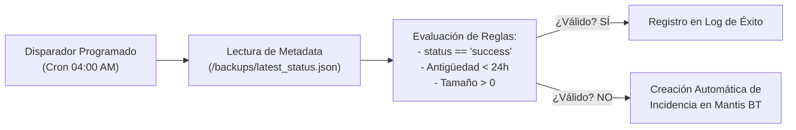

# Flujo n8n 2: Verificación de Backups y Notificación Automática de Errores

- **Ticket:** SCRUM-77
- **Épica:** SCRUM-13 (E11 · Automatización con n8n)
- **Responsable:** Valentín Lozano
- **Fecha:** 12/11/2026
- **Estado:** Implementado y versionado

---

## 1. Arquitectura del Flujo de Automatización

El flujo se ejecuta dentro del contenedor `n8n` (`infra/n8n/workflows/flujo-2-verificacion-backups.json`) y opera de forma desacoplada con respecto al proceso de volcado:

---

## 2. Reglas de Validación
1. **Ventana de Ejecución:** El proceso de backup de PostgreSQL (`SCRUM-37`) se ejecuta diariamente a las 03:00 AM. El flujo de n8n se dispara 1 hora después (04:00 AM).
2. **Chequeo de Integridad:** Inspecciona el archivo estructurado `/backups/latest_status.json` generado por el script `backup.sh`.
3. **Criterio de Alarma:**
   - Si el archivo no existe.
   - Si `status != 'success'`.
   - Si la marca temporal es superior a 24 horas (indicando que el backup no corrió).
4. **Acción ante Fallo:** Envía un payload HTTP POST hacia la API REST de Mantis Bug Tracker (`http://mantis/api/rest/issues`) para crear automáticamente una incidencia con severidad `major` categorizada en `Infraestructura`.
