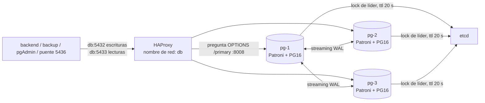

# Implementación de Patroni: failover automático de PostgreSQL

Guía del cluster de base de datos de GymHub con **Patroni**. Explica qué cambió, cómo se prueba la caída del maestro (lo que se muestra en la defensa) y cómo se migra producción.

## Índice

- [1. Qué hace el nuevo enfoque](#1-qué-hace-el-nuevo-enfoque)
- [2. Cómo decide Patroni quién es el líder](#2-cómo-decide-patroni-quién-es-el-líder)
- [3. Levantar el cluster en desarrollo](#3-levantar-el-cluster-en-desarrollo)
- [4. Prueba de failover: bajar el maestro](#4-prueba-de-failover-bajar-el-maestro) ← **lo de la defensa**
- [5. Otras pruebas](#5-otras-pruebas)
- [6. Qué mirar en el monitoreo](#6-qué-mirar-en-el-monitoreo)
- [7. Resultados medidos](#7-resultados-medidos)
- [8. Migrar producción](#8-migrar-producción)
- [9. Limitaciones](#9-limitaciones)
- [10. Archivos que cambiaron](#10-archivos-que-cambiaron)

---

## 1. Qué hace el nuevo enfoque

**Antes** (SCRUM-45/48): un primario `db` y una réplica `db-replica` con roles fijos. Si se caía el primario, alguien tenía que entrar, ejecutar `pg_promote()` en la réplica, cambiar `DB_HOST_PRIMARY` en el backend y reiniciarlo. Mientras tanto, la app no podía escribir.

**Ahora**: tres nodos PostgreSQL iguales (`pg-1`, `pg-2`, `pg-3`), cada uno manejado por **Patroni**. En todo momento uno es el **líder** (acepta escrituras) y los otros dos son **réplicas** (copias en vivo por streaming). Si el líder se cae, **Patroni promueve solo a una réplica**, y cuando el nodo caído vuelve, **se reincorpora solo como réplica**. Nadie toca nada.



| Pieza | Para qué |
|---|---|
| **Patroni** (dentro de cada nodo) | Arranca PostgreSQL, lo configura como líder o réplica, lo vigila y lo promueve si hace falta. Expone una API REST en el puerto 8008 |
| **etcd** | Guarda **quién es el líder**: una clave con vencimiento. No guarda datos de la app |
| **HAProxy** | Punto de entrada único. Pregunta a cada nodo por su API (`/primary`, `/read-only`) y manda las conexiones al que corresponde |

**La clave para no tocar la app:** HAProxy tiene el nombre de red **`db`** y escucha en **5432**, igual que la base vieja. El backend, el backup, pgAdmin y el puente de administración siguen apuntando a `db:5432` y **siempre llegan al líder**, sea cual sea. En la PC se mantienen los puertos de siempre: **5433** (líder) y **5434** (lecturas). `backend/.env` no cambia.

---

## 2. Cómo decide Patroni quién es el líder

1. El líder **renueva cada 5 s** (`loop_wait`) una clave en etcd que **vence a los 20 s** (`ttl`).
2. Las réplicas ven esa clave y saben quién manda.
3. Si el líder se cae:
   - **Apagado ordenado** (`docker stop`): Patroni libera la clave al salir, así que la elección es inmediata.
   - **Caída abrupta** (`docker kill`, corte de luz): nadie renueva la clave y vence a los 20 s.
4. La réplica **más actualizada** toma la clave y se promueve. Una réplica atrasada más de 1 MB de WAL no puede ser candidata (`maximum_lag_on_failover`).
5. HAProxy detecta en ~4 s que el nuevo líder responde 200 en `/primary` y le manda las conexiones. El backend reconecta solo.
6. Cuando el viejo líder vuelve, Patroni ve que ya hay otro líder. Lo rebobina con **`pg_rewind`** hasta el punto en que divergieron y lo engancha como réplica. Si el rebobinado no pudiera hacerse, lo vuelve a clonar desde cero, también solo.

---

## 3. Levantar el cluster en desarrollo

> **Windows (Git Bash):** antes de los comandos `docker exec … /etc/patroni/…` ejecutar una vez `export MSYS_NO_PATHCONV=1`. Si no, Git Bash convierte la ruta a `C:/Program Files/Git/etc/...` y `patronictl` no encuentra la configuración.

```bash
# 1 líder + 2 réplicas (para probar failover). Los nodos 2 y 3 se clonan solos del líder la primera vez
# (con la base de 6M filas, unos minutos).
docker compose -f docker-compose.yml --profile dev --profile cluster up -d

# Solo para programar (1 nodo, menos RAM): mismo puerto 5433, el backend no nota la diferencia.
docker compose -f docker-compose.yml --profile dev up -d
```

El `-f docker-compose.yml` es obligatorio: en la carpeta también está `compose.yaml` y Compose elegiría ese.

**Ver el estado del cluster** (se puede ejecutar desde cualquier nodo encendido):

```bash
docker exec demo_hia_pg_1 patronictl -c /etc/patroni/patroni.yml list
```

```
+ Cluster: gymhub-dev (7709686479990337570) -------------+-----+------------+-----+
| Member | Host | Role    | State     | TL | Receive LSN | Lag | Replay LSN | Lag |
+--------+------+---------+-----------+----+-------------+-----+------------+-----+
| pg-1   | pg-1 | Leader  | running   |  2 |             |     |            |     |
| pg-2   | pg-2 | Replica | streaming |  2 |  1/C4000060 |   0 | 1/C4000060 |   0 |
| pg-3   | pg-3 | Replica | streaming |  2 |  1/C4000060 |   0 | 1/C4000060 |   0 |
+--------+------+---------+-----------+----+-------------+-----+------------+-----+
```

- **Role**: `Leader` o `Replica`.
- **State**: `running` en el líder y `streaming` en una réplica sana.
- **TL** (timeline): sube en 1 cada vez que cambia el líder.
- **Lag**: atraso de la réplica (0 = al día).

Otras formas de ver quién es el líder:

| Cómo | Comando o dirección |
|---|---|
| Página de HAProxy | **http://localhost:7000**: en la sección `primary`, el nodo en **verde** es el líder; en `replicas`, todos los nodos sanos |
| Desde SQL (pgAdmin, DBeaver, psql) | Conectarse a `localhost:5433` y ejecutar `SELECT inet_server_addr(), pg_is_in_recovery();` (`false` = líder) |
| API de Patroni | `docker exec demo_hia_pg_1 wget -qO- http://pg-1:8008/cluster` |
| Historial de cambios de líder | `docker exec demo_hia_pg_1 patronictl -c /etc/patroni/patroni.yml history` |

---

## 4. Prueba de failover: bajar el maestro

### Opción A: script automático (recomendada para la defensa)

```bash
bash database/patroni/failover-demo.sh dev            # con pausas (Enter para avanzar)
bash database/patroni/failover-demo.sh dev --sin-pausa
```

El script hace todo y lo explica en pantalla:

1. Muestra el cluster y el líder actual.
2. Ejecuta `docker stop` sobre el contenedor del líder.
3. Espera a que una réplica tome el control y muestra **cuántos segundos tardó**.
4. Escribe en la base a través de HAProxy (`db:5432`) para mostrar que se volvió a poder escribir. Usa una tabla temporal, así que **no deja datos**.
5. Vuelve a encender el viejo líder y muestra que **volvió como réplica** sin intervención.

Salida real en esta PC:

```
== 1. Estado inicial del cluster
   Líder actual: pg-1 (demo_hia_pg_1)
== 2. Se cae el maestro: docker stop demo_hia_pg_1
== 3. Esperando que una réplica tome el control
   ✔ Nuevo líder: pg-3, en 3 s
== 4. La app sigue escribiendo por HAProxy (db:5432), sin cambiar configuración
   escritura OK en 172.19.0.4/32 (en recuperación: false)
   ✔ La base volvió a aceptar escrituras 6 s después de la caída
== 5. Vuelve el viejo maestro: docker start demo_hia_pg_1
   pg-1 quedó como: Replica streaming
   ✔ Se reincorporó solo como réplica (pg_rewind o reclonado automático).
```

### Opción B: paso a paso, a mano

Conviene tener **dos terminales**: una para mirar el cluster y otra para tirar el nodo.

**Terminal 1: mirar el cluster en vivo**

```bash
# Linux / macOS
watch -n 1 'docker exec demo_hia_pg_2 patronictl -c /etc/patroni/patroni.yml list'

# Windows (Git Bash no trae watch)
export MSYS_NO_PATHCONV=1
while true; do clear; docker exec demo_hia_pg_2 patronictl -c /etc/patroni/patroni.yml list; sleep 1; done
```

Usar un nodo que **no** sea el que se va a bajar. Si `pg-2` es el líder, mirar desde `demo_hia_pg_3`.

**Terminal 2: la prueba**

```bash
# 1. ¿Quién es el líder? (por ejemplo pg-1 → contenedor demo_hia_pg_1)
docker exec demo_hia_pg_2 patronictl -c /etc/patroni/patroni.yml list

# 2. Bajar el maestro. Elegir uno de los dos:
docker stop demo_hia_pg_1      # apagado ordenado: nuevo líder en ~3 s
docker kill demo_hia_pg_1      # caída abrupta (como un corte de luz): nuevo líder en ~20-25 s

# 3. En la terminal 1 se ve a pg-1 pasar a "stopped" y a otra réplica pasar a "Leader".
#    En http://localhost:7000 cambia el nodo en verde.

# 4. Comprobar que la app sigue funcionando, SIN reiniciar el backend ni tocar .env
curl http://localhost:3000/api/health          # {"status":"ok","db":"up",...}
#    y en el navegador (http://localhost:4200): iniciar sesión, crear o editar algo.

# 5. Comprobar desde SQL que el puerto de siempre ahora llega al nuevo líder
psql -h localhost -p 5433 -U demo_hia -d demo_hia -c "SELECT inet_server_addr(), pg_is_in_recovery();"

# 6. Volver a encender el viejo maestro: se reincorpora solo como réplica
docker start demo_hia_pg_1
#    En la terminal 1: pg-1 aparece como "Replica" y en unos segundos "streaming", con el TL nuevo.

# 7. Ver el registro de los cambios de líder
docker exec demo_hia_pg_2 patronictl -c /etc/patroni/patroni.yml history
```

Si se usó `docker kill`, en los logs del nodo que vuelve se ve el rebobinado:

```bash
docker logs demo_hia_pg_1 2>&1 | grep -i rewind
# INFO: running pg_rewind from pg-3
# INFO: pg_rewind exit code=0
```

### En la Forma B (todo en contenedores) y en producción

Los mismos comandos sirven cambiando el nombre de los contenedores:

| Entorno | Contenedores | Script |
|---|---|---|
| Forma A (`docker-compose.yml`) | `demo_hia_pg_1`, `demo_hia_pg_2`, `demo_hia_pg_3` | `failover-demo.sh dev` |
| Forma B (`compose.yaml` + `compose.dev.yaml`) | `gymhub_pg_1_dev`, `gymhub_pg_2_dev`, `gymhub_pg_3_dev` | `failover-demo.sh devb` |
| Producción (servidor) | `gymhub_pg_1_prod`, `gymhub_pg_2_prod`, `gymhub_pg_3_prod` | `failover-demo.sh prod` |

> ⚠️ En **producción**, el failover corta las escrituras de los usuarios reales durante unos segundos. Hacerlo solo en una ventana acordada con el equipo y después de un backup (ver [sección 8](#8-migrar-producción)).

---

## 5. Otras pruebas

**Switchover: cambiar el líder a propósito, sin caída** (por ejemplo, antes de reiniciar un nodo para mantenimiento):

```bash
docker exec demo_hia_pg_1 patronictl -c /etc/patroni/patroni.yml switchover --leader pg-1 --candidate pg-2 --force
```

**Reiniciar PostgreSQL en un nodo sin provocar failover** (por ejemplo, después de cambiar `postgresql.conf`):

```bash
docker exec demo_hia_pg_1 patronictl -c /etc/patroni/patroni.yml restart gymhub-dev pg-1 --force
```

> Un `docker restart` **del líder** sí provoca failover. Para reiniciar la base del líder sin cambiarlo, usar `patronictl restart`.

**Caída de etcd** (la pieza única del laboratorio):

```bash
docker stop demo_hia_etcd
#   El líder SIGUE aceptando escrituras (failsafe_mode, ver sección 9). Mientras etcd esté abajo
#   no puede haber failover.
docker start demo_hia_etcd     # todo vuelve a la normalidad solo
```

**Actualizar la imagen de los nodos sin cortar la base** (de a un nodo: primero las réplicas, al final el líder):

```bash
docker compose -f docker-compose.yml --profile dev --profile cluster build pg-1
docker compose -f docker-compose.yml --profile dev --profile cluster up -d --no-deps pg-2   # réplica
docker compose -f docker-compose.yml --profile dev --profile cluster up -d --no-deps pg-3   # réplica
docker compose -f docker-compose.yml --profile dev --profile cluster up -d --no-deps pg-1   # líder: failover controlado
```

---

## 6. Qué mirar en el monitoreo

Prometheus lee la API de Patroni de los 3 nodos (job `patroni`, `pg-N:8008/metrics`). En desarrollo, el monitoreo se levanta sumando el overlay que lo conecta a la red de la base:

```bash
docker compose -f infra/monitoring/docker-compose.yml -f infra/monitoring/docker-compose.patroni-dev.yml \
  --env-file infra/monitoring/.env up -d
```

**Grafana** (http://localhost:3001, tablero *GymHub | Monitoreo general*, al final):

| Panel | Qué muestra |
|---|---|
| Líder del cluster (Patroni) | El nombre del nodo líder, en verde |
| Rol por nodo | 1 = líder, 0 = réplica. En un failover se ve la línea de un nodo bajar y la de otro subir |
| Nodos del cluster encendidos | 3 en verde, 2 en naranja |
| Atraso de cada réplica | Bytes de WAL que le faltan a cada réplica |
| Cambios de líder en 1 h | Cuántos failovers o switchovers hubo |

**Alertas** (http://localhost:9093 o Prometheus → *Alerts*):

| Alerta | Cuándo |
|---|---|
| `GymHubNodoPatroniCaido` | Un nodo no responde durante 30 s |
| `GymHubFailoverOcurrido` | Cambió el líder en los últimos 10 min (informativa: **queda en *firing* después de la demo**) |
| `GymHubSinLider` | Ningún nodo acepta escrituras durante 30 s |
| `GymHubDosLideres` | Más de un líder a la vez (*split-brain*) |
| `GymHubReplicasInsuficientes` | Menos de 2 réplicas en streaming durante 5 min |
| `GymHubReplicaLagAlto` | Una réplica atrasada más de 16 MB |

Se quitaron `GymHubReplicaDesconectada` y `GymHubReplicaNoEsStandby`: suponían que la réplica era siempre el mismo contenedor.

---

## 7. Resultados medidos

Pruebas hechas en una PC de desarrollo (Linux, 5,7 GB de RAM), con la base de 6M filas por tabla:

| Prueba | Resultado |
|---|---|
| Adopción de la base existente (sin dump/restore) | `pg-1` tomó el volumen de siempre: 6.000.000 de pagos e índices de SCRUM-39.1 intactos. Patroni borró solo el slot viejo `standby_slot_1` |
| Clonado de cada réplica nueva | ~7 GB, unos 3 minutos |
| `docker stop` del líder | Nuevo líder en **3-4 s**; escrituras de nuevo a los **6-7 s** |
| `docker kill` del líder (caída abrupta) | La **app** (`POST` real del backend) volvió a escribir a los **26 s**, sin reiniciarse |
| Reincorporación del viejo líder | Como réplica en `streaming` en **4-8 s**. Tras `docker kill`, con `pg_rewind` automático |
| Switchover controlado | Sin errores; el líder cambia en segundos |
| etcd caído 35 s | Con `failsafe_mode` el líder siguió aceptando escrituras; al volver etcd, todo siguió igual |
| Cluster nuevo (volumen vacío) | `post-bootstrap.sh` crea la base `demo_hia` y carga esquema y seed; la réplica se suma sola |
| `/api/health` durante un `docker stop` | Respondió 200 en todo momento |

---

## 8. Migrar producción

> **Hecho el 20/11/2026.** Producción corre sobre Patroni: corte de 3 min 17 s, réplicas clonadas en 52 s y failover probado en producción (nuevo líder en 23 s, `/api/health` 200 todo el tiempo). Detalle y evidencias: [evidencias/SCRUM-48-produccion](evidencias/SCRUM-48-produccion/README.md). Se levantó por etapas (líder → app → réplicas) antes del release, para que el `--wait` de 240 s del CD no cortara el clonado.

Producción tiene hoy `gymhub_db_prod` (primario) y `gymhub_db_replica_prod` (réplica). La migración **adopta** el volumen del primario (`gymhub_prod_db_data`): no hay que exportar ni importar los datos. Es el mismo procedimiento que ya se probó en desarrollo con la base de 6M.

> `scripts/deploy.sh` **se niega a desplegar** mientras existan `gymhub_db_prod` o `gymhub_db_replica_prod`. Si no lo hiciera, `pg-1` arrancaría sobre el mismo volumen que el contenedor viejo y dos PostgreSQL escribiendo los mismos archivos corrompen la base. Por eso los pasos 1 a 4 se hacen **antes** de mergear a `main`.

Lo ejecuta quien administra el servidor (Francisco), en una ventana avisada al equipo. Son unos 30 minutos, con la app sin base durante la migración. En Git Bash, primero `export MSYS_NO_PATHCONV=1`.

**0. Antes de empezar**
- Disco libre: al menos **4 veces el tamaño de la base**, por los 3 nodos y la copia. `docker system df -v | grep gymhub_prod_db_data` da el tamaño del volumen.
- Agregar a `produccion/.env.prod`: `PATRONI_RESTAPI_USERNAME=patroni` y `PATRONI_RESTAPI_PASSWORD=<aleatoria>`. Sin ella, el deploy falla a propósito.

**1. Backup lógico** (por si todo lo demás falla):
```bash
docker exec gymhub_backup_prod /scripts/backup.sh
docker exec gymhub_backup_prod ls -lh /backups | tail -3
```

**2. Parar la app y la base vieja:**
```bash
docker stop gymhub_backend_prod gymhub_backup_prod gymhub_db_replica_prod gymhub_db_prod
```

**3. Copia en frío del volumen del primario** (es el plan de vuelta atrás):
```bash
docker run --rm -v gymhub_prod_db_data:/de:ro -v gymhub_prod_db_data_pre_patroni:/a alpine sh -c 'cp -a /de/. /a/ && du -sh /a'
```

**4. Borrar los contenedores viejos y el volumen de la réplica vieja** (las réplicas nuevas se clonan desde el líder):
```bash
docker rm gymhub_db_prod gymhub_db_replica_prod
docker volume rm gymhub_prod_db_replica_data
```

**5. Desplegar:** mergear el release a `main`. El CD ejecuta `scripts/deploy.sh <sha>` y levanta etcd, `pg-1` (que adopta los datos), `pg-2` y `pg-3` (que se clonan), HAProxy, el backup, el backend y el frontend. Si hace falta hacerlo a mano en el servidor: `bash scripts/deploy.sh <sha>`.

**6. Verificar:**
```bash
docker exec gymhub_pg_1_prod patronictl -c /etc/patroni/patroni.yml list   # 1 Leader + 2 Replica streaming
docker exec gymhub_pg_1_prod psql -U gymhub -d gymhub -Atc "SELECT slot_name FROM pg_replication_slots"
#   Deben aparecer solo los slots de pg_2 y pg_3. Si quedara 'standby_slot_1':
#   docker exec gymhub_pg_1_prod psql -U gymhub -d gymhub -c "SELECT pg_drop_replication_slot('standby_slot_1')"
curl -s http://127.0.0.1/api/health
```

Después, recrear el monitoreo con `bash scripts/infra.sh levantar`, que suma Prometheus a la red de la base y quita el exporter de réplica viejo. Si `gymhub-postgres-exporter-replica-prod` queda creado, borrarlo con `docker rm -f gymhub-postgres-exporter-replica-prod`.

**7. Limpiar:** cuando todo funcione unos días, borrar la copia con `docker volume rm gymhub_prod_db_data_pre_patroni`.

**Volver atrás**:
1. `docker compose -p gymhub-produccion … down`, **sin `-v`**.
2. Revertir el release en `main`.
3. Restaurar la copia:
   ```bash
   docker run --rm -v gymhub_prod_db_data_pre_patroni:/de:ro -v gymhub_prod_db_data:/a alpine sh -c 'rm -rf /a/* && cp -a /de/. /a/'
   ```
4. Redesplegar la versión anterior.

---

## 9. Limitaciones

- **Un solo servidor físico.** Los 3 nodos corren en la misma PC. Patroni cubre la caída de un **contenedor o proceso** de PostgreSQL, no un apagado o un corte de luz de la PC, ni una falla del disco. Para eso harían falta nodos en máquinas distintas.
- **Un solo etcd** (por recursos). Si cae:
  - con `failsafe_mode: true`, el líder sigue aceptando escrituras mientras vea a todas las réplicas;
  - pero mientras etcd esté abajo **no puede haber failover**.

  La configuración "de libro" usa 3 etcd para tener quórum.
- **Replicación asíncrona.** En una caída abrupta se pueden perder las últimas transacciones que la réplica todavía no recibió. Con lag 0 (lo normal) no se pierde nada. Patroni no elige como líder a una réplica atrasada más de 1 MB.
- **Corte de unos segundos.** Durante el failover, las escrituras en curso fallan. Son ~6 s con `docker stop` y ~25 s con una caída abrupta, por el `ttl` de 20 s. Bajar el `ttl` acelera el failover, pero aumenta el riesgo de failovers falsos ante una pausa breve.
- **Recursos.** Cada nodo reserva 512 MB de `shared_buffers` y tiene un límite de 1-1,3 GB. En una PC con poca RAM, programar con `--profile dev` (1 nodo) y usar `--profile cluster` solo para probar failover.
- **No levantar a la vez la Forma A y la Forma B**: usan la misma red (`gymhub_db_net`), los mismos nombres de nodo y los mismos puertos.

---

## 10. Archivos que cambiaron

| Archivo | Cambio |
|---|---|
| `database/patroni/Dockerfile` | Imagen `gymhub-patroni:16`: `postgres:16-alpine` + Patroni 4.1.4. Mantiene Alpine para que las collations y el uid sean los mismos que en la base vieja y se pueda adoptar el volumen |
| `database/patroni/patroni.yml` | Configuración común de los nodos (ttl, pg_rewind, slots, failsafe, pg_hba). Reutiliza `database/config/postgresql.conf` |
| `database/patroni/haproxy.cfg` | Puerto 5432 → líder, 5433 → lecturas, 7000 → página de estado |
| `database/patroni/post-bootstrap.sh` | Carga esquema y seed en un cluster nuevo (reemplaza a `docker-entrypoint-initdb.d`) |
| `database/patroni/failover-demo.sh` | Demo de failover (reemplaza a `database/replication/failover-test.sh`) |
| `docker-compose.yml`, `compose.yaml`, `compose.dev.yaml`, `compose.prod.yaml` | `db` y `db-replica` se reemplazan por `etcd`, `pg-1..3` y `haproxy` (alias `db`) |
| `scripts/deploy.sh` | Nueva lista de servicios + guardia contra los contenedores viejos |
| `infra/monitoring/…` | Job `patroni`, alertas y paneles nuevos, overlay `docker-compose.patroni-dev.yml`. Se eliminó el exporter de réplica fija (`docker-compose.replica.yml`) |
| `database/replication/` | Se borraron `setup-primary.sh`, `entrypoint-replica.sh` y `failover-test.sh` (Patroni hace ese trabajo). `verify-replication.sh` apunta a `db` y a un nodo réplica |
| `database/dataset/cargar.sh`, `database/analisis/**` | El contenedor por defecto pasa a `demo_hia_pg_1` (tiene que ser el líder) |
| `.env.example`, `produccion/LEEME.md` | `PATRONI_RESTAPI_USERNAME/PASSWORD`, `HAPROXY_STATS_PORT` |
| **Sin cambios** | Código del backend, `backend/.env`, backup, puente `db-puente`, `servers.json` de pgAdmin |
